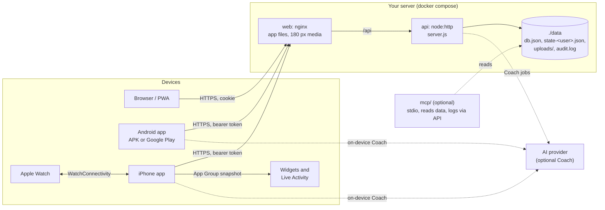
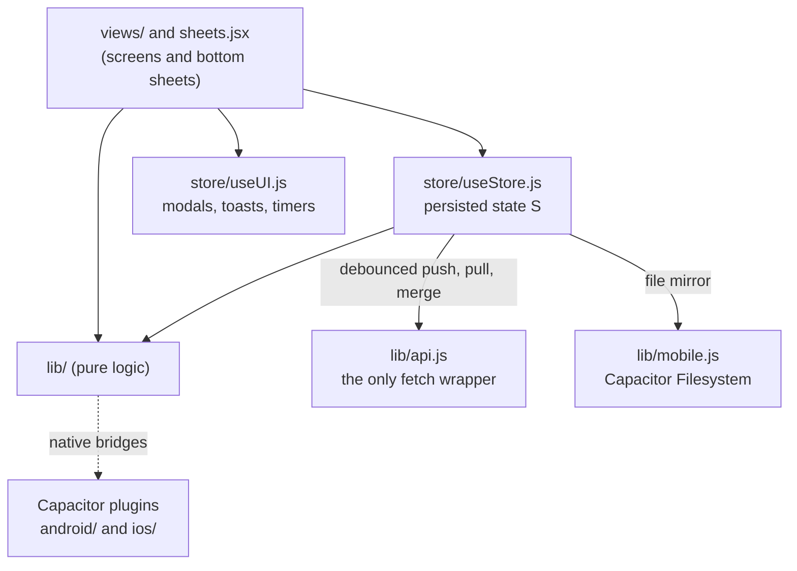
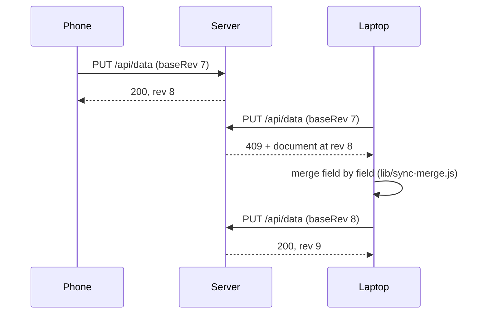
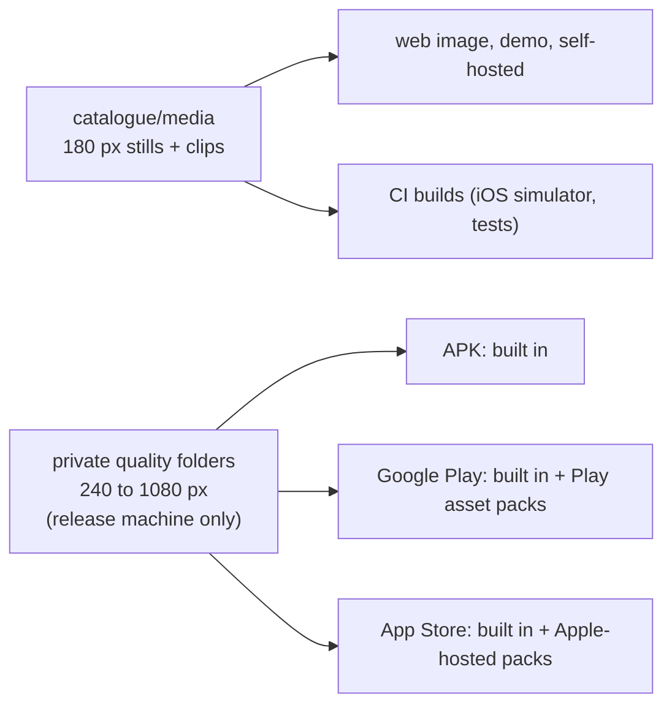
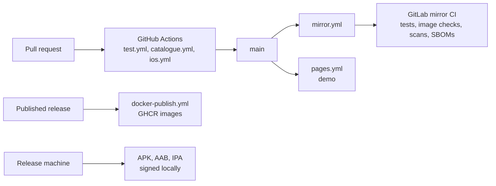

# How openGym fits together

A map of the code for people about to change it. For running an instance, read
[SELF_HOSTING.md](SELF_HOSTING.md); for the phone apps, [MOBILE.md](MOBILE.md) and
[APP_STORES.md](APP_STORES.md).

## The big picture

One React app runs everywhere: in a browser against your server, inside the Android and iPhone
apps (Capacitor), and as the browser-only demo. The server is small on purpose: plain `node:http`,
JSON files on disk, passkeys for sign-in.

The phone apps also work with no server at all. Then the phone is the account and the state lives
in a file in the app's private storage (MOBILE.md explains the modes).

## The repository

| Path | What lives there |
|---|---|
| `frontend/src/` | The app. `App.jsx` routes to `views/` (one file per screen), `sheets.jsx` holds the bottom sheets, `components/` the shared UI, `store/` the two Zustand stores, `lib/` the logic |
| `frontend/src/lib/` | Pure helpers, each with a `*.test.js` beside it: progression, 1RM, recovery, sync merge, imports, media, the native bridges |
| `frontend/src/locales/` | One pack per language. The key is the English text, English itself has no pack |
| `frontend/src/{instr,exercise-names,exercise-desc}/`, `lib/exercises-data.js` | Generated from `catalogue/` by `scripts/catalogue/build.mjs`. Don't edit by hand |
| `frontend/android/`, `frontend/ios/` | The Capacitor shells and the native plugins (rest alarm, Health Connect, Apple Health, watch, widgets, animation packs) |
| `api/` | `server.js` (routes, sessions, storage), plus small modules split out so they can be tested alone: `media.js`, `sync-stamps.js`, `queue.js`, `nudge.js`, `rate-limit.js`, `durable.js`, `password.js`, `passkeys-store.js`, `device-link.js` |
| `api/coach/` | The optional AI Coach. `core/` has no server state and is shared with the phone apps |
| `web/` | The nginx image: builds the frontend, adds `catalogue/media`, proxies `/api` |
| `catalogue/` | The exercise database: one JSON per exercise, translations, the licensed 180 px media |
| `mcp/` | Optional MCP server for AI clients: reads the data folder, `log_workout` saves through the API |
| `scripts/` | Build and release helpers, see [scripts/README.md](../scripts/README.md) |
| `website/` | opengym.ch, plain HTML |
| `helm/`, `kubernetes/`, `contrib/nix/` | Other ways to deploy |

## Frontend

- **State.** `useStore.js` holds everything a profile owns (`S`): routines, workouts, weigh-ins,
  settings. It is saved to `localStorage`, mirrored to a file on the phones (WebView storage can be
  evicted), and pushed to the server when signed in. `useUI.js` is everything that should not
  survive a reload.
- **Logic in `lib/`.** Anything that decides what you lift next, or reads a logged session back, is
  a pure function with a test beside it. Views stay thin.
- **Platform switches.** `lib/mobile.js` (`MOBILE`), `lib/channel.js` (APK or store build) and the
  `VITE_DEMO` flag for the demo. Native code is only reached through Capacitor plugins.

## Sync

Each profile is one JSON document with a server revision. A device sends the revision it last
saw; if someone else wrote in between, the server answers 409 with the current document, and the
device merges and tries again.

Every change carries its own timestamp, down to one setting or one field of a routine, so the merge
keeps the newest edit of each and a deletion stays deleted. The server applies the same rules for
writers that don't stamp (older apps, API scripts) in `api/sync-stamps.js`.

## Code that exists twice on purpose

The API image only contains `api/`, so a few rules are hand-copied from the frontend instead of
imported. When you change one side, change the other in the same pull request:

| Frontend | Server | Held together by |
|---|---|---|
| `lib/sync-merge.js` | `api/sync-stamps.js` | `lib/sync-stamps-parity.test.js` runs both on the same cases |
| `lib/glyphs.js` | `api/coach/core/glyphs.js` | `lib/coach-parity.test.js` |
| `lib/nudge.js` | `api/nudge.js` | mirrored cases in `lib/nudge.test.js` and `api/test/nudge.test.js` |
| `lib/queue.js` | `api/queue.js` | mirrored cases in `lib/queue.test.js` and `api/test/queue.test.js` |

The last two have no test that compares the code itself, so a change on one side only is not
caught automatically.

The Coach goes the other way: `frontend/src/lib/coach-local.js` imports `api/coach/core/` directly,
so the phone apps run the same prompts and validation as the server. That is why the web image
copies `api/coach/core/` into its build stage.

## Server

`api/server.js` is a single `node:http` server. Routes are keys of one object
(`routes['GET /api/health']`), matched on method and path. Storage is two kinds of JSON file under
`DATA_DIR`: `db.json` for users, passkeys, invites and push subscriptions,
and one `state-<uid>.json` per profile. Every write goes to a temp file first and is renamed over
the old one (`durable.js`), so a crash never leaves half a file.

Sign-in is a passkey (`@simplewebauthn/server`), optionally a password, plus a signed session
cookie. Phones get the same signed session as a bearer token, made by pairing with a one-time code
(`device-link.js`). Every route is listed in `api/openapi.yaml`, and `openapi-routes.test.js` fails
when the two disagree.

## Exercise media

The animations are licensed from Gym visual and not covered by the AGPL (NOTICE.md). The licence
decides where each size may go, and the build follows it:

Nothing larger than 180 px is ever committed, served by a server, or uploaded to CI. The store
packages are put together and signed on the release machine (`scripts/android/build-release.sh`,
`scripts/ios/finish-ipa.sh`).

## Native extras (iPhone)

- **Apple Watch** (`ios/App/Watch`, logic in the `WatchCore` Swift package with its own tests):
  the phone sends a snapshot of the running workout (`lib/watch-sync.js` →
  `WatchBridgePlugin.swift`), the watch runs the session on its own, and sends back small events
  ("set done") that the phone applies through the workout screen's own actions.
- **Widgets and the Live Activity** (`ios/App/OpenGymWidgets`): the page writes a small snapshot to
  the App Group (`lib/widgets.js` → `WidgetBridgePlugin.swift`), the widgets read it.
- **Animation packs** (`ios/App/AnimationPacksDownloader`, `AnimationPacksPlugin.swift`): the
  sharper animation sizes as Apple-hosted Background Assets.

## CI and releases

GitHub is the home of the project. GitLab is a fast-forward-only mirror. Release steps are in
[APP_STORES.md](APP_STORES.md) and the [changelog](../CHANGELOG.md) format is described at its top.
