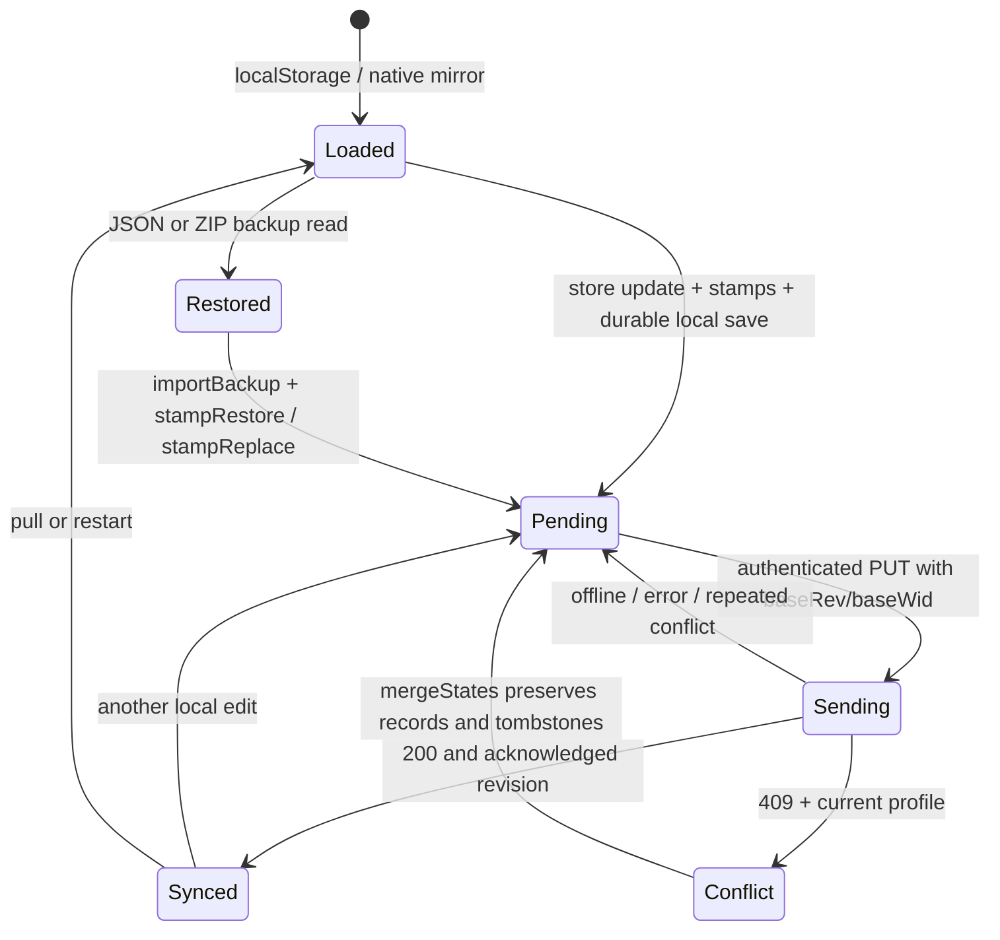

# Profile and optional-feature data contracts

EP-01, based on `cefce38b` and the real client, API and MCP paths below. This is an
extension of the existing JSON profile, not a new datastore. No optional module entry,
network integration, default profile field or dependency is introduced here.

## Existing representation and persistence

`frontend/src/store/useStore.js` owns `S`. `loadState` overlays the saved object onto
`DEF` with `Object.assign`, preserving unknown keys. `draftOf` copies changed values;
`update` calls `stampChange` and `persist`. `persist` writes `stateJson(S)` to
`localStorage.gym_state_v1`; sync/owner/write markers live in separate localStorage keys.
`stateJson` caches the unchanged workout array's serialization but emits exactly
`JSON.stringify(S)` key order and bytes. Normal edits still advance `_ts`; imports still
apply defaults and restore stamps. EP-01 does not promise that those pre-existing
mutating operations are byte-identical. An untouched JSON load/save is byte-identical,
and optional hooks add no fields to legacy profiles (`sync-contract-characterization.test.js`,
`contracts-fixtures.test.js`; existing `state-json.test.js`).

On mobile, `nativeSave` in `lib/mobile.js` serializes the same complete object to
`opengym-state.next.json`, then renames to `opengym-state.json` in private Data storage.
`nativeLoad` considers both files after an interrupted write. The fallback writes the
main file if rename is unavailable. Store saves of active workouts request an immediate
mirror; other writes are debounced. EP-01 changes neither path. Native filesystem behavior
is covered by existing mobile tests; no physical phone has been tested for this epic.

The API stores one `state-<uid>.json` through temp-file/rename durability. Auth selects
`uid`; it is never taken from a profile field. `GET /api/data` returns the profile and
revision. `PUT /api/data` compares `baseRev` and, when supplied, `baseWid` before writing.
A mismatch returns **409 with the current document**, without applying the submitted edit.
A missing base revision is the existing deliberate-replace/old-writer path. `active` is
removed on the server; `_rev`, `_wid`, `_wids` are server bookkeeping. `stampPut` handles
unstamped writers and merges stamp records; it is not the client's general workout merger.

`lib/api.js` throws an error carrying `status` and parsed `data`; it does not itself merge.
`useStore.doPush` catches 409, calls `mergeInto`/`mergeStates`, and retries against the
returned revision. Repeated conflicts leave pending changes for a later retry. The real
HTTP protocol is exercised in `api/test/contracts-http.test.js`; existing store conflict
suites exercise the client retry orchestration.

## Existing clocks and extension points

| Mechanism | Meaning and restrictions |
|---|---|
| `S._ts` | Document edit clock, not record creation time or event occurrence time. `stampChange` lifts time above all known stamps. |
| `S.edited[field]` | Top-level setting edits, including an omitted value's deletion. `PER_KEY` expands week, dayPlan, exNotes, barWeights, exAliases, programmes and modules into dotted per-key stamps. |
| `record._ts`, `record._f[field]` | Entry edit time and independent top-level field clocks. Nested objects/arrays are atomic fields. Existing `stampEntry` is reused. No second vector clock or deletion mechanism. |
| `S.deleted[collection][id]` | Positive deletion time; negative deliberate add-back time. Greater absolute time wins; a negative value wins an equal-time tie. |
| `resetAt`, `resetIds` | Reset epoch and exact ids removed. A legacy reset without ids uses timestamps. Reset inventories now include registered optional collections. |
| `OPTIONAL_COLLECTIONS` | Explicit reserved keys: `nutritionEntries`, `activities`, `providerLinks`, mirrored in client/API. No keys materialize in a legacy profile. Later collections require registry/parity tests; arbitrary unknown arrays are not automatically mergeable. |
| `mergeOptionalEntries` | Generic id union with per-field clocks. UTF-16 string ordering and recursively sorted JSON break equal-time value ties; no locale-sensitive comparator. A positively stamped omission beats a value at the same stamp. Unstamped absence is not deletion. |
| `visibleOptionalEntries(S, key)` | Mandatory read projection for these collections. Positive tombstones hide retained rows, regardless of later incidental edits. Re-add requires an explicit negative stamp. Never render or total the raw arrays. |
| `S.modules` | Only explicit choices are saved. Existing entries default on, except existing check-in fallback; `optIn: true` entries default off. No new entries added in EP-01. |
| Provider metadata | `providerLinks` contains only portable non-secret references. Credentials and live availability are server-owned, never profile authority. |

Optional record input must be an object with a nonempty safe string id. Nulls, arrays,
primitives, missing ids and prototype-sensitive ids are ignored. The helper tolerates
older records with absent field clocks and preserves unknown fields. Domain validators in
EP-04/EP-07 must additionally validate UUID, schema, ranges and units before saving;
this generic merger is not nutrition/activity input validation. Unknown schema versions
must be retained and shown as unsupported, not destructively normalized.

### Retention, reset and prefer rules

Optional deletions retain the row and its field clocks plus the existing `deleted` entry.
This prevents an early two-device merge from throwing away a field needed to converge with
a third device. Optional tombstones are not subject to the legacy 5,000-stamp eviction;
optional reset inventories likewise do not evict ids at the legacy 20,000-id cap;
legacy collections retain their existing caps. There is no safe tombstone garbage collector
without knowing every replica's acknowledgement. Record growth is therefore bounded by
the existing API request/document limits, not automatic deletion of old evidence.

**A logical delete is not erasure.** Hidden content remains in profile files, local storage,
native mirrors, MCP raw reads and backups, and may contain nutrition or activity details.
Turning a module off never removes data. A reset hides optional records with tombstones;
it also is not cryptographic or physical erasure. Future hard-erasure work must cover
all replicas, backups and provider storage explicitly; do not market the visible projection
as permanent deletion. Avoid storing routes or sensitive provider payloads unless the user
explicitly opts in. No raw camera frames belong in these collections.

A reset records optional ids and converts them into ordinary deletion stamps. A stale
replay cannot undo the reset. In an ordinary merge both copies' deletion evidence survives.
For `prefer`, the preferred account owns its existing records and their deletion/reset
choices; a nonpreferred guest reset must not wipe an account record. Guest-only rows retain
their own deletion evidence, so a hidden guest record is not imported as live. `prefer`
is intentional authority selection, not a commutative concurrent edit operation.

Backup **replay** is an ordinary merge and cannot clear a deletion. A deliberate user
restore (`stampRestore`) restamps the live backup fields and records explicit add-backs;
records already hidden in that backup stay hidden. Replace (`stampReplace`) records
removals of omitted live entries and retains evidence. Later readers must use the projection
after restore, reset, merge and offline load, not only after server sync.

## Compatibility findings and reproducible evidence

Paths below are relative to `frontend/src/lib/` unless qualified. Tests use synthetic data
and no exercise media.

| Path | Baseline finding and final guarantee | Evidence |
|---|---|---|
| Current server, unstamped PUT | `keepUnknown` already preserved unknown top-level and known-entry fields. Optional-entry preservation is now included; missing whole registered collections survive either writer mode. | `sync-contract-characterization.test.js`; `api/test/contracts-http.test.js` |
| Current server, stamped PUT | Arbitrary unknown omissions remain writer-owned. EP-01 preserves registered optional collections; it does **not** redefine every stamped setting omission. | `sync-contract-characterization.test.js`; HTTP test |
| Client 409 merge | Baseline dropped an unstamped top-level key present only in the older document, and unstamped entry keys omitted by a newer version. Minimal preservation now keeps them; explicit field/top-level deletion and reset boundaries still win. | RED `sync-preservation.test.js`, now GREEN |
| New optional id collections | Baseline kept one entire list, losing concurrent adds/edits. Now deterministic per-field union plus deletion evidence. Equal clocks, collision, replay, all three-device permutations, reset, prefer, malformed values and older schema are covered. | `sync-optional.test.js`; `api/test/sync-optional.test.js`; shared `__fixtures__/contracts/merge-cases.mjs` |
| All registry keys | Nutrition full cases plus parameterized activities/providerLinks add/edit/delete, store stamping and server stamping; mirrored helpers checked on 300 seeded pairs. | `sync-optional.test.js`; `sync-stamps-parity.test.js` |
| Backup export/read/import | JSON and ZIP export preserve unknown profile and routine fields through the actual reader, store import and localStorage persistence. `backup-media.js` sanitizes known media references; it is not a field whitelist. | `../store/useStore.contracts.test.jsx`; existing `backup-roundtrip.property.test.jsx` |
| MCP read and log_workout | Disk reader retains unknown fields. `log_workout` clones the GET document and rebuilds on a returned 409 document, then PUTs through the API. It does not whitelist away unknown fields. Existing read tools do not gain knowledge of new optional data. | `mcp/test/contracts.test.js`, existing `mcp/test/log-workout.e2e.test.js` |
| Legacy serialized profile | JSON load/serialization unchanged; optional hooks inject no fields into legacy documents. Existing store edit clocks remain intentional behavior. | `sync-contract-characterization.test.js`; `contracts-fixtures.test.js` |
| Module defaults | Missing/invalid values are off only for declared opt-in entries. Explicit boolean choices, every existing module, check-in fallback and unknown-id behavior are unchanged and nonmutating. | `modules.opt-in.test.js`; existing `modules.test.js` |

**Old binaries are not upgraded by this change.** An older deployed client/server may still
collapse unknown lists to one side, drop unknown fields locally, or interpret its own reset
without the optional inventory. The updated server protects registered records on later PUTs,
but cannot reconstruct evidence already lost on an old server or in an offline-only old client.
Do not enable EP-04/EP-07 multi-device editing until participating devices and the server have
these hooks. Older-client compatibility tests simulate request shapes against this server;
they do not certify every historical app binary. Older backups remain portable inputs,
not evidence that arbitrary old merge implementations converge.

## Canonical records for EP-04 and EP-07

Collection fields are arrays keyed by immutable UUID string `id`, with `schemaVersion: 1`.
UUIDs for manual records are random v4. Imports must derive a deterministic UUID from a
stable namespaced idempotency key (or retain an already persisted mapping) before the first
save, so simultaneous retries/devices do not allocate different ids for the same source item.
EP-01 supplies merge hooks and fixtures, **not** the future importer/dedup implementation.

| Field | Contract |
|---|---|
| `id`, `schemaVersion` | UUID identity, current version 1. Omitted/version 0 is legacy input; missing values remain unknown. Do not rewrite records simply on read. Future migrations are explicit, id-preserving and tested. |
| `createdAt`, `createdBy` | Immutable ISO UTC creation time and `manual`, `file-import`, `provider-import` or `provider-link`. Never infer this from `_ts`. |
| `source` | Stable origin: manual, tcx, gpx, fit, open-food-facts, nutritrace, mealie, fittrackee, etc. Provenance survives local corrections. |
| `externalId` | Provider/source id, scoped by provider and connection/source account. Omit when unavailable. Never a credential. |
| `contentFingerprint` | `sha256:` plus lowercase hex of the bounded canonical source content, computed before local corrections. For file imports hash original bounded bytes. Exclude secrets and volatile fetch times. |
| `idempotencyKey` | Stable source namespace + opaque account/connection namespace + external id, or a content fingerprint if no id exists. Same source update preserves id; a newer fingerprint updates fields with normal stamps. Never deduplicate two manual meals just because contents match. |
| `occurredAt`, `day`, `timeZone` | UTC instant plus persisted local calendar day `YYYY-MM-DD` and IANA zone chosen at entry/import. Use occurrence zone, not server/next reader's zone. Travel or later profile timezone changes never refile saved days. For date-only input keep the day and zone without fabricating an instant. Missing legacy timezone is unknown; ask at import if needed. |
| `_ts`, `_f`, `deleted` | Reuse the existing numeric logical timestamps described above. Stamp every initial top-level field, then changed fields only; omitted stamped field means deletion. Optional undo is a newly stamped edit/add-back, not `_u` conditional legacy undo metadata. |

`nutritionEntries` stores a confirmed nutrient snapshot: `label`, `amountG`, `energyKcal`,
`proteinG`, `carbohydrateG`, `fatG` (and later explicitly named nutrients with canonical units).
Unknown nutrient values are omitted/null, never silently zero. Source serving units and
conversion factors must accompany non-gram input. Nutrients are amounts for the saved entry,
not an ambiguous per-100g value. Catalog changes never silently rewrite diary entries.

`activities` stores `type`, `durationSec`, `distanceM`, optional `movingDurationSec`,
`ascentM`, and provenance/original units. Use seconds, metres, kilograms and explicit
coordinate conventions for any later route schema. Never put activity records into workouts
unless a separate user-confirmed conversion is implemented. Profile kg/lb switches do not
convert these canonical optional values (`contracts-fixtures.test.js`).

`providerLinks` stores portable metadata only: `source`, opaque `serverConnectionId`,
`direction`, `authority`, optional label. A restored reference does not reconnect a provider.
Secrets, full capability URLs, access/refresh tokens and live "connected" assertions do not
belong in the profile or backup. Query the authenticated server for current availability.

Fixtures: `nutrition-entry.json`, `activity.json`, `provider-link.json`,
`tombstoned-profile.json`, `older-nutrition-entry.json` under
`frontend/src/lib/__fixtures__/contracts/`. The older fixture deliberately lacks nutrients
and timezone. The tombstoned profile shows both retained payload and positive deletion stamp.

| External system | Authority for saved canonical data | Only permitted initial conversion direction |
|---|---|---|
| Open Food Facts | openGym confirmed diary snapshot; catalog is lookup input | Product lookup → confirmed openGym nutrition snapshot |
| NutriTrace | openGym local diary; no dual journal authorship | User-selected bounded remote entries → openGym import |
| Mealie | openGym confirmed meal snapshot | Recipe/serving input → openGym nutrition snapshot |
| FIT/TCX/GPX files | openGym saved activity | Local file preview → user-confirmed openGym activity |
| FitTrackee | openGym imported activity | Selected remote activity → openGym activity; no automatic write-back |
| Node-RED / webhook receivers | openGym source records | openGym event envelope → receiver; no inbound record authoring |

These are contracts, not shipped integrations or claims about third-party API availability.
Changing authority or adding reverse conversion needs a separate decision and tests. Existing
Health/watch integrations keep their existing behavior and are not rewritten by this table.

## Server provider adapter security contract

Existing reference: `api/integrations/index.js`, `store.js`, `crypto.js`, `outbox.js`,
`providers/webhook.js`, `net-guard.js`. The current adapter interface declares `id`, `kind`,
category/events, configuration requirements, connection cap/rates, `connect`, optional
`update`, and `deliver(job, reveal)`. The hub authenticates ownership, seals credentials,
limits user actions, schedules deliveries, and revokes connections and queued jobs.

Every **new** server adapter must meet these requirements before integration:

1. Fixed provider origin, or an operator-configured origin on an exact allowlist. Never use
   arbitrary model/client-supplied URLs as fetch targets. Revalidate protocol, origin and DNS
   on every request; reject credentials-in-URL, loopback/link-local/metadata/private addresses
   by default, mixed DNS responses and rebinding. Use the guarded connection lookup, not only
   a preflight DNS lookup. Refuse redirects or independently validate every destination without
   forwarding authorization. LAN access requires explicit operator configuration and must not
   allow loopback/link-local. The existing webhook intentionally permits user-chosen public
   receivers, with `net-guard` checks, rather than a fixed service allowlist.
2. Credentials stay in the server integration store: AES-256-GCM, fresh nonce, HKDF-derived key,
   AAD bound to user/connection/field, atomic 0600 files. A different user cannot reveal them.
   Profile backups contain only connection references; server recovery requires the original
   server secret and protected integration directory. Losing/rotating the key means reauthorize.
3. Explicit finite connect/total timeouts and streamed response-size limits **before parsing**.
   The reference webhook uses 10 seconds and a 2,048-byte response read cap. New JSON adapters
   must reject truncated/oversized bodies rather than treating an HTTP success as valid data.
4. Per-user action, per-connection and per-instance rate limits; bounded queue and attempts,
   exponential backoff with jitter and bounded Retry-After. Opt-out, missing configuration or
   provider failure must leave workout logging/offline saves usable.
5. No secrets in public info, errors, logs, response bodies or metrics. Redact token/capability
   URLs and untrusted exception text; log stable error codes and bounded safe messages only.
6. Availability distinguishes disabled, unconfigured, configured/unverified, checking, available,
   unavailable, needs-reauthorization and revoked, with a checked-at timestamp when meaningful.
   Storing credentials is not proof of connectivity; stale success is not live availability.
7. Stable idempotency identity across retries. Preserve external id/fingerprint and canonical
   units; retrying cannot duplicate imports. Non-idempotent upstream actions require an explicit
   idempotency facility or reconciliation before retry. HTTP 429/5xx are not success.
8. Revoke removes local sealed credentials and queued jobs immediately, prevents further work,
   and requests upstream token revocation when supported. A failed remote revoke is reported
   honestly. No restored profile reference silently reauthorizes. Cross-user access fails closed. New opt-in server work must require an explicit true module
   choice as well as configured credentials; a frontend visibility flag alone is not authorization.

`api/test/provider-contract-checklist.mjs` is a reusable, transport-injected checklist for
adapter rate declarations, non-network configuration, secret/public-info separation, failed
responses and stable delivery identity. `provider-contract.test.js` applies it to the existing
webhook. Existing `integrations.test.js` and `server-integrations.test.js` cover sealing/AAD,
DNS guards, rate buckets, outbox replay and disconnect. These tests are not certification of
an unimplemented adapter; each new adapter needs malicious DNS, streamed-size, timeout,
credential-expiry and revoke tests for its own protocol.

Two **existing limitations** must not be copied into new providers: the webhook hub labels a
configured connection `connected` before a successful delivery (`lastOk` distinguishes it),
and generic network errors in `webhook.judge` can copy exception text into its message.
`provider-contract.test.js` characterizes the latter with a synthetic secret string. EP-01
adds no provider and does not modify integrations runtime files; tightening legacy status/error
behavior is a separately scoped follow-up, not a claim that those existing paths already meet
the stronger contract above.

## Evidence and review status

The plan and RED commits precede implementation. Initial RED: optional/default-off frontend
13 failures/2 passes; API optional 10 failures/2 passes; preservation+backup characterization
2 failures/7 passes. Reset/prefer boundaries were expanded before core edits. Actual HTTP tests
then found an optional unknown-field omission, fixed through the existing preservation helper.
Independent parent probes added RED cases for preferred-account resets, unstamped record
union and large stamp maps before corrections. Full-suite results belong in the PR/handoff;
the final run passed all 7,876 frontend, 833 API and 140 MCP tests, plus build and
all required checks (exact commands and evidence in `EP-01-tasks.md`).

Correction to commit `411aed42` message: expanded parity+optional run was **32 passed**, not
33. Earlier focused frontend 143, API 45 and MCP 2 counts refer to those exact selected runs,
not the final suite totals. Linux reference CI 43498778572: frontend 7,832 tests/651 files,
API 800 tests, MCP 138 tests/5 files. Windows baseline failures are not accepted as Linux failures.
