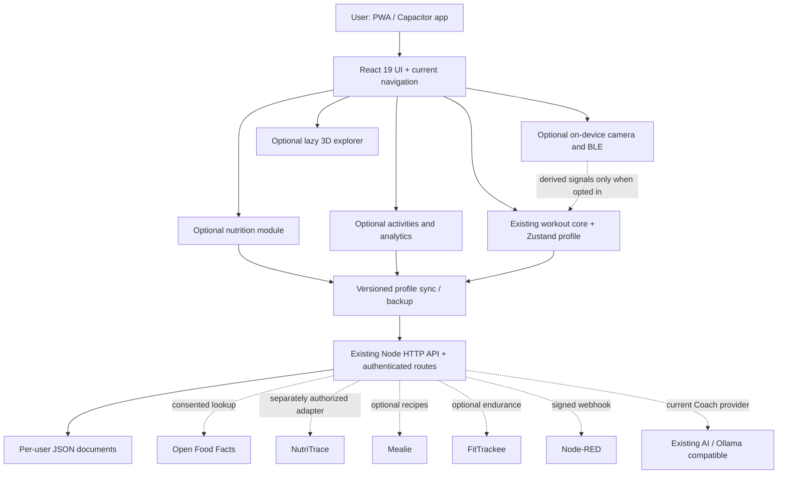

# openGym Next — Master Implementation Plan

> **For agentic workers:** Use `superpowers:brainstorming` to approve each independently scoped feature design, `superpowers:using-git-worktrees` for isolated work, `superpowers:writing-plans` to refine each feature into checkable tasks, and `superpowers:subagent-driven-development` (preferred for risky modules) or `superpowers:executing-plans` to implement it. For each behavior change: RED → GREEN → REFACTOR → verify → commit → review. This is a **master roadmap**, not permission to merge or deploy.

**Goal:** Turn the user's clean openGym fork into one premium, reliable, privacy-preserving, modular fitness and performance application with nutrition, advanced insights, optional movement and sensor features, and safe AI.

**Architecture:** Retain openGym's React 19/Vite, Zustand profile state, Node `node:http` API, JSON-file storage, Capacitor apps, existing sync protocol, AI coach, integrations, and MCP. Add bounded feature modules and user-consented provider adapters; do not integrate whole external applications into the core. Leave third-party services optional, separately deployed, and replaceable.

**Tech stack:** React 19, JavaScript/JSX, Vite, Zustand, Node 22, Vitest, Node `node:test`, Docker/nginx, Capacitor; selected optional Motion, Apache ECharts, Open Food Facts, sports-lib, MediaPipe, Three.js/React Three Fiber/Drei, BLE plugin; independently deployed NutriTrace, Mealie, FitTrackee, Node-RED, Ollama where proven necessary.

**Spec:** `docs/product/PRODUCT_SPEC.md` and `docs/product/ARCHITECTURE_DECISIONS.md` in this package. Convert these into repository files only on an authorized planning branch. Underlying baseline references: [`CLAUDE.md`](https://github.com/sorensadrgit-art/openGym/blob/main/CLAUDE.md), [`docs/ARCHITECTURE.md`](https://github.com/sorensadrgit-art/openGym/blob/main/docs/ARCHITECTURE.md), [`NOTICE.md`](https://github.com/sorensadrgit-art/openGym/blob/main/NOTICE.md), [`docs/MODULES.md`](https://github.com/sorensadrgit-art/openGym/blob/main/docs/MODULES.md).

**State verified 2026-11-13:** `sorensadrgit-art/openGym` has only `main`, and `main` equals upstream `DuarteSantos8/openGym` at `68dad18f8ffaa20e8d69d936f9acd16233098b3d`. PR #1 and #2 were closed unmerged; past code and draft branches are no longer part of the fork's live branches. All new features described below are **planned**, not installed.

## Global constraints

1. Do **not** redesign the application by migrating its framework, replacing its storage or auth, or rewriting its existing workout engine. New behavior must be additive and justified.
2. Preserve existing workout logging, routine progression, Health Connect/Apple Health, native watch support, offline standalone mode, PWA and server sync. Existing module switches must continue to hide features without deleting their data.
3. Follow the repository's JavaScript/JSX structure and Node 22 CI. No unapproved TypeScript migration or new database.
4. Every new persisted field has versioning, migration, backup/export/import parity, 409 conflict-handling, deletion/tombstone semantics and older-client compatibility tests.
5. All providers disabled until activated. No fabricated connection status, mock data mislabeled as live data, or credentials in browser/localStorage/source control.
6. Never send camera footage, workout history, nutrition diary or other user health information to an external provider without relevant purpose, clear consent, minimized scope and documented behavior.
7. Treat health, nutrition and camera estimates as informational; no diagnosis, injury prediction or treatment claims without dedicated clinical validation and legal review.
8. openGym code is AGPL-3.0; Gym visual exercise media is separately licensed. Do not repurpose or use that media in AI generation. Review each new model/dataset/asset license independently.
9. No push to shared default branch, PR merge, production deploy, app-store publish, private data migration, service restart, secret rotation, or destructive operation without explicit authorization.
10. Keep the old closed PRs available only for lessons learned; do not cherry-pick them or reuse unverified changes blindly.

## Review focus — highest-risk inputs and failure modes

- Two offline devices edit nutrition/activity entries and one deletes a record: no loss, resurrection or duplication on reconnect.
- A user connects/disconnects NutriTrace/Mealie/FitTrackee: revoked credentials cannot keep syncing; one authoritative record prevents feedback loops.
- A malformed, huge or hostile activity/food/provider payload: bounded parsing, no SSRF, no crash, no cross-user data exposure.
- A weak camera angle, obscured joints or low-confidence tracking: visibly uncertain outcome and manual correction, not false clinical feedback.
- An existing user upgrades, restores a backup or uses an older phone build: new fields survive round-trips, old workout data never changes unexpectedly.

## 1. Product definition

**Working name:** openGym Next, an internal project title only. Public branding and commercial distribution require a separate decision.

**Audience:** individual lifters who want private, fast workout logging; people who track food and endurance activity; strength coaches viewing their own authorized data; users exploring fitness-related movement feedback. An optional future **rehabilitation education** environment may support learning, but is not a medical device or clinician-facing record system in the initial release.

**One product promise:** Log a workout instantly; understand your progress; choose optional food, motion, sensor and coaching capabilities without compromising reliability or data ownership.

**Must-have user journeys:**

- A returning user opens Today, starts a prescribed workout, logs a set, sees rest time, and saves it—offline or online—with no new navigation burden.
- The user searches for a food by text/barcode, checks serving size, logs/corrects/deletes food, and sees accurate daily totals. An offline manual entry syncs later with no duplication.
- The user reviews real training metrics by time window, compares personal progress and understands when a value is unavailable rather than seeing fake zeroes.
- The user previews a FIT/TCX/GPX file locally, then deliberately imports it as an outdoor activity, with units, source and duplicate detection.
- An explicitly consenting user opens camera form feedback for one supported exercise, sees confidence/limitations, can correct counts and can stop the camera instantly.
- Optional 3D body exploration works independently of workout logging and has a fast non-WebGL fallback.

**Non-goals for initial release:** medical diagnosis, automatic PT prescriptions, raw video upload by default, a full social network, a marketplace, automatic mass import of external users' records, replacement of Apple Health/Health Connect, a mandatory AI runtime, or rewriting openGym as a suite of separately forked applications.

## 2. Source of truth and integration boundaries

| Domain | Authority | Optional provider | Rule |
|---|---|---|---|
| Workouts/routines/sets | Existing openGym profile `S` | Liftosaur rules (import/evaluation) | Never let provider overwrite workout history without a preview and approval. |
| Nutrition diary | openGym's new versioned nutrition records | NutriTrace service as explicit optional adapter | Exactly one designated writer at a time; initial provider integration is read/preview or controlled import, not uncontrolled bidirectional sync. |
| Food product catalog | Open Food Facts data, locally normalized | Local custom food | Source, units, timestamp and data limitations retained; third-party images require separate rights. |
| Recipes/meal planning | Mealie where connected, otherwise local simple recipes | — | No hidden duplication of diary entries; recipe to diary is an explicit action. |
| Outdoor activity history | New openGym activity entries | sports-lib parser; FitTrackee service | Imported event has stable source fingerprint, provenance and normalized units. |
| Health/wearable samples | Platform health store or explicit BLE source | Device providers | No duplicate heart rate data; prefer existing phone health connectors until a direct BLE case is justified. |
| Pose observations | Ephemeral on-device processor | MediaPipe; Sports2D as separately authorized analysis | Discard camera frames by default; derived metrics remain clearly approximate. |
| AI suggestions | User-reviewed proposals | Existing Coach/Ollama, optional LangGraph | AI is never an authority over stored workouts, nutrition or clinical decisions. |
| Automation | openGym signed events | Node-RED | Signed event contracts, delivery attempts, idempotency and explicit secrets; no raw health payload by default. |

**Critical nutrition design choice:** The default diary is local-first and belongs to openGym. NutriTrace is a distinct optional nutrition service: verify its federation API, scopes, deployment and backup behavior, then choose a **one-way authorized exchange** or explicit per-user provider mode. Bidirectional synchronization is an additional feature with its own design and conflict tests; never implement it implicitly.

**Data model conventions, to confirm against code before implementing:** per-entry UUID, immutable creation source, normalized measurement units, updated field stamps, explicit deletions/tombstones, `schemaVersion`, stable external provider IDs and import hashes, idempotent operations, single selected daily timezone for date grouping, and documented serialization/backups. Respect openGym's `_ts`, `_f`, and `edited` model rather than inventing an incompatible mechanism.

## 3. Target architecture



**Do not route cameras or WebGL through the Node server.** Keep those client-side when technically feasible. Use dynamic imports and feature-based loading. Preserve current authentication and per-profile access controls in server-side adapters.

**Proposed file boundaries (verify before coding):**

- `frontend/src/views/Nutrition.jsx`, `frontend/src/components/nutrition/*`, `frontend/src/lib/nutrition/{schema,validation,merge,totals,imports}.js`
- `frontend/src/lib/food/{open-food-facts,normalize}.js`, `api/integrations/providers/{open-food-facts,nutritrace,mealie}.js` (actual provider structure must be inspected)
- `frontend/src/views/Activity.jsx`, `frontend/src/lib/activity/{parse,normalize,dedup}.js`
- `frontend/src/components/analytics/*`, `frontend/src/lib/analytics/*`
- `frontend/src/lib/progression/liftoscript*.js` only if clear incremental value beyond existing progression
- `frontend/src/lib/pose/*`, `frontend/src/components/pose/*`, `frontend/src/lib/ble/*`
- `frontend/src/components/body3d/*`, `frontend/src/lib/anatomy/*`
- `api/integrations/providers/{fittrackee,node-red}.js` when an existing integration mechanism can support them
- Feature-gate integration in `frontend/src/lib/modules.js`, `frontend/src/views/Settings.jsx` or their actual equivalents; add locale keys and route tests.

**File locations above are proposals, not claims that they currently exist.** Preserve adjacent conventions and do not let one screen become a thousand-line orchestration file.

## 4. Design system and motion direction

- **Character:** restrained premium dark, performance-first, technical and cinematic. Use subtle depth, clean typography, purposeful highlights, generous spacing, high legibility; not a generic neon dashboard.
- **Colors:** near-black layered surfaces, neutral grays, a single configurable accent, semantic success/warning/error states. Honor existing themes and theme variables before adding tokens.
- **Type:** responsive heading hierarchy with tabular numerals for metrics, minimum readable labels, strong contrast. No illegible hairline text under dark glass.
- **Layout:** mobile-first Today/Workout priority; desktop progressive enhancement with two-column insights; no controls hidden behind hover on touch.
- **Motion:** subtle shared-layout motion, spring-based sheets, staggered entry only for nonessential visual elements, exit transitions that never block recording a set. Keep most microinteractions within roughly 160–280 ms and structural transitions around 250–450 ms as initial design guidance, then measure in browser. Native reduced-motion fallback; no autoplaying 3D camera movement as a default.
- **3D:** targeted lazy route, texture/mesh LOD, frame-rate adaptive quality, keyboard-accessible 2D equivalent, explicit fallback if WebGL unsupported, idle/no-workout GPU use near zero.
- **Product surfaces:** Home / Today, Workout, Plan, Nutrition, Insights, Activity, Body Explorer, Coach, Integrations, Settings. Add navigation progressively; avoid introducing all tabs at once.

**Usability acceptance:** core set logging stays as quick as upstream, critical controls have at least 44×44 CSS-pixel touch targets where practical, no color-only status, dialogs trap/fix focus correctly, WCAG 2.2 AA targets for new screens, readable charts with tabular alternatives, tested 320 px through desktop, RTL/locales checked, reduced-motion and high text scaling supported.

## 5. Execution roadmap — independent milestones

Status of all stages: **NOT STARTED on the clean fork**. Each phase has its own feature spec, code branch, tests and PR.

| Stage | Epic | Deliverable | Depends on | Exit evidence |
|---|---|---|---|---|
| 00 | Baseline, safety & CI | Known-green upstream baseline, test matrix, clean worktree, rollback inventory | none | CI and existing core flows verified; deviations documented |
| 01 | Contracts & modularity | Versioned schema proposals, module registry contract, provider security interface | 00 | Schema fixtures, compatibility/security review |
| 02 | Design foundation | Refined accessible tokens/components and initial Motion only where needed | 00 | Visual QA on Today/Workout, no behavior regression |
| 03 | Analytics | ECharts enhancements for real training series and honest empty states | 01,02 | Real data, unit, range and reduced-motion tests |
| 04 | Nutrition diary | Local-first foods/meals/servings/totals with safe sync and backups | 01,02 | Offline concurrent-edit, deletion and round-trip tests |
| 05 | Food lookup | User-initiated Open Food Facts lookup and provenance | 04 | API, rate-limit, privacy, barcode and missing-field tests |
| 06 | Nutrition services | NutriTrace pilot; Mealie recipe flows with consent and API separation | 04,05 | Token isolation, auth, idempotency, outage/revoke tests |
| 07 | Activity import | sports-lib FIT/TCX/GPX preview plus intentional import and dedup | 01,03 | Fixture parsing and offline-to-server replay tests |
| 08 | Endurance service | FitTrackee optional sidecar integration | 07 | Recorded routes without double-authority or leaking location |
| 09 | Programming | Liftosaur/Liftoscript evaluation only for missing advanced functionality | 01 | Golden progression cases, no baseline progression change |
| 10 | Pose/camera | MediaPipe for one or two bounded exercises; Sports2D optional export | 02 | Confidence, permission, camera-off, unsupported-device tests |
| 11 | Sensors | BLE pilot for named supported sensors, using existing health connectors first | 10 optional | Permission and disconnect/reconnect tests on real hardware |
| 12 | 3D anatomy | R3F/Drei/Three.js interactive optional body view, licensed geometry | 02,03 | Asset clearance, mobile/WebGL fallback, performance QA |
| 13 | AI coaching | Extend existing Coach; Ollama provider evaluation; LangGraph only if needed | 04,09 optional | Prompt-injection/data-scope tests, user confirmation for writes |
| 14 | Automation | Signed webhook → Node-RED recipe or operator-managed sidecar | 01 | Replay, signatures, secret expiry, rate/error tests |
| 15 | Rehab learning sandbox | Optional nonclinical educational motion views; possible Sports2D/OpenSim research | 10,12 | Explicit informational scope and no unsupported medical claims |
| 16 | Final hardening & launch | Security, backup, accessibility, real-device tests, release docs | chosen stages | Go/no-go checklist; staged rollback verified; owner approves release |

**MVP cut:** stages 00–05 plus required parts of 16. Everything from 06 onward is opt-in, ordered by proven user value. Do not hold an excellent workout/nutrition product hostage to experimental ML or 3D.

## 6. Detailed work packages and completion gates

The companion files in `docs/superpowers/plans/` break these epics into RED/GREEN/REFACTOR review tasks with proposed file paths and tests. Below are the critical acceptance cases.

### A. Foundation, architecture and UI

- **Audit:** collect exact toolchain, CI evidence, current features and side effects; compare staging demo vs known upstream; record upstream commit and source-license inventory.
- **Git:** fresh `feat/...` worktree from clean main; `upstream` remote preserved; one small PR per independently useful change; never commit secrets or `.env`.
- **Architecture:** API/provider contract review, canonical data ownership table, schema versioning, capability registry, consent and error states; no route returns mock connected status.
- **Visual:** accessible tokens, a maximum of one visually distinct primary action per card, reusable metric card/chart/skeleton/empty state, no loading animation delaying set input.
- **Done:** baseline suite remains green or pre-existing failures documented with reproduction; visual screenshots compared across mobile/desktop/dark/light/reduced-motion.

### B. Nutrition, food and recipes

1. Model personal food records and serving semantics: source food ID, per-100 nutrition, serving grams/mL when known, total derived from quantities, user-entered corrections, timezone/day, revisions and deletions.
2. Unit-test calculations for zero, missing data (unknown ≠ 0), rounded servings, unit conversion, day boundaries, allergens, invalid values and food edits.
3. Integrate with openGym's state and sync; two-device tests: concurrent add/add, add/edit, edit/delete, reconnect, restore an older backup, older app ignoring new fields.
4. Add diary view and basic barcode or manual search. No background lookups, no unreviewed image reuse, no outsourced auth.
5. Add Open Food Facts via a server-managed fixed-domain adapter, app-identifying User-Agent, strict barcode validation, bounded response/caching, consent and published data attribution. API unavailable must not block manual diary.
6. Pilot NutriTrace using its documented federation contract on an isolated instance. Prove scoped tokens, source-of-truth rule, import dedup and revocation before implementing provider writes.
7. Connect Mealie for authorized recipe lookups and one-way conversion into selected meal/serving entries. Do not mutate existing meals without confirmation.
8. **Done:** every diary action survives reload, offline work, simultaneous-device merge, export/import and backup restore; all totals reconcile to recorded source quantities.

### C. Performance and activities

1. Extend analytics from existing workout data; avoid a new ingestion service or duplicate bodyweight charts. Track estimated 1RM, sets/volume, consistency, exercise trends and source completeness.
2. Dynamic import ECharts with proper cleanup; add textual summaries and a data table fallback; preserve unit conversions and non-reduced-motion neutrality.
3. Add sports-lib file selection/previews to a dedicated route, explicit consent before persist, bounded files, GPX/TCX/FIT fixture tests, canonical time zones and metric units.
4. Add `activities` records with source fingerprints and import idempotency; do not stuff GPS training data into strength-workout records.
5. Pilot FitTrackee only if route-history, maps and detailed endurance analytics are really needed. Keep credentials and location-sharing scopes isolated.
6. **Done:** import the same file twice creates one activity, edits sync safely, invalid file cannot crash app, and analytics show which records they include.

### D. Progression and intelligent training

1. Inspect existing openGym progression policies and its existing Liftosaur importer. Identify a concrete unsupported target before adding any new evaluator.
2. If justified, implement a versioned, deterministic Liftoscript evaluator behind a feature gate; sandbox expressions, bound CPU/iterations, validate units, prohibit network/file execution, and store exact source + policy version.
3. Test golden cases for reps achieved, failed sets, deload, missing units, program change, manual override, and historical replay. Show a preview and explicit approval of automatic changes.
4. **Done:** original progression behavior remains identical when the feature is off; all saved targets can be regenerated from versioned inputs.

### E. MediaPipe, specialist analysis and sensors

1. Create camera permissions, instructions, explicit start/stop, camera-device selection and an on-device pose prototype on one simple movement. Record no raw video by default.
2. Handle confidence, occlusion, poor framing, other people, paused background tabs, lower-power devices and model loading failures. Expose editable rep counts and transparent limitations.
3. Evaluate Sports2D only for dedicated, clearly labeled offline/consented 2D video review; validate planar-camera assumptions and model licenses.
4. Investigate named BLE devices only after selecting specific supported hardware. Use permission-based pairing, reconnect logic, unit normalization and timestamp dedup. Do not replace Apple Health/Health Connect.
5. **Done:** camera LED stops after exit, sensor/ML can be disabled instantly, no medical diagnoses, and there is a manual workout path when every sensor is unavailable.

### F. 3D anatomy and educational boundaries

1. Build an optional Three.js + React Three Fiber v9 + Drei viewer only after React 19 compatibility tests; load on a dedicated route.
2. Decide asset license before import: BodyParts3D code and geometry have different terms, including geometry attribution/share-alike obligations. Do not copy NC datasets or Gym visual media into this feature.
3. Implement body/muscle selection linked to existing exercise groups, with a 2D accessible fallback, pointer/touch/keyboard support and low-GPU mode.
4. Rehabilitation-oriented overlays must be explicitly educational; clinical claims, patient recording, individual rehab recommendations, and OpenSim biomechanical estimates require separate validation/privacy review.
5. **Done:** no rendering regression to Today/Workout, asset manifest is auditable, unsupported GPUs still navigate the product.

### G. Existing AI, local models and workflows

1. Reuse the existing AI Coach and its OpenAI-compatible endpoint support (including Ollama). Do not add LangGraph merely because it exists.
2. Introduce a separate tool/agent orchestrator only if the Coach needs durable multi-step workflows that its current implementation cannot provide. Keep tools read-only by default, with user confirmation for proposed changes.
3. Add prompt-injection and exfiltration tests; verify model output can never directly overwrite routines/diary entries without schema validation and user approval. Redact sensitive logs.
4. Configure Node-RED as a separate, opt-in consumer of openGym's existing signed webhooks. Test HMAC signature, duplicate delivery, replay prevention, refusal of internal URLs and backoff.
5. **Done:** AI/network errors do not stop workouts; the user can turn every integration off without losing core data.

## 7. Release engineering and quality gates

### Tests for every feature PR

1. **RED:** a focused unit/integration test fails for the intended new behavior (not merely missing import from an empty file if richer behavior can be specified).
2. **GREEN:** implement minimum change, rerun focused test, verify result.
3. **REFACTOR:** clean duplication, rerun tests.
4. **REGRESSION:** run relevant neighboring tests and the repository's complete frontend/API/MCP suites as required by scope.
5. **BUILD:** frontend production build and docs/source-generation checks. For native features add Android/iOS compilation on the appropriate runner/device.
6. **BROWSER:** Playwright/DevTools screenshots on actual rendered app, keyboard, responsive and reduced-motion flows. Review console, failed network requests and performance.
7. **SECURITY:** dependency and secret scans, auth/authz negative cases, SSRF/sensitive-log checks.
8. **REVIEW:** separate spec-compliance and code-quality review; address blocking feedback; preserve passing CI evidence in the PR description.

### Baseline commands (from repository CLAUDE.md; verify before use)

```bash
npm ci
cd frontend && npm ci && npm test && npm run build
cd ../api && npm ci && npm test
cd ../mcp && npm ci && npm test
cd ..
cd frontend && node scripts/check-locales.mjs && node scripts/check-source-strings.mjs --strict
cd ..
node scripts/catalogue/build.mjs --check
node scripts/build-coach-assets.mjs --check
node scripts/build-api-docs.mjs --check
```

Run targeted tests during TDD; full runs at integration gates. If a test requires socket binding/hardware and the cloud sandbox blocks it, record **blocked** and use a suitable authorized staging runner before claiming E2E coverage. A regression seen on clean upstream must be documented separately, not silently waved away.

### Proposed performance budgets (targets, not verified measurements)

- Google Core Web Vitals on a defined reference device: LCP under 2.5 s, INP under 200 ms and CLS under 0.1 for key screens where achievable. Measure baseline first and report regressions rather than blindly treating synthetic numbers as success.
- Lazy-load ECharts, sports parsers, pose ML models and WebGL scenes; do not add them to initial Home/Workout route cost.
- Avoid network calls to third parties until the user opens/uses that feature or explicitly enables a scheduled sync.
- No blocking frame work or sensor inference while entering/editing sets; measurable 60 fps target for ordinary UI transitions on reference hardware, with reduced-work fallback.
- Track bundle-size delta, JS parsing and memory consumption before and after each optional dependency.

### Staging requirements

- Isolated hostname and `RP_ID`/`ORIGIN`, separate data directory, secret inventory and test users; never mirror real health/user data into staging without permission and sanitization.
- Build images **from the fork source** rather than pulling upstream prebuilt web/API images for custom changes.
- Test passkeys, offline → online sync, 409 conflicts, app switch/background, mobile viewport, exports, service outage and end-to-end logs.
- Take a verified backup before migrations and demonstrate a restore using synthetic data.

### Final go/no-go

- No critical/high security findings; no unresolved P0/P1 bugs in chosen launch scope.
- All required CI checks green or explicitly blocked by a documented environment constraint with equivalent approved verification.
- Offline and backup/restore proven; migrated profile round-trip verified.
- Accessibility and visual review completed on tested browser/device matrix.
- Licenses, asset attributions and AI model terms documented, with any commercial/media conflicts resolved.
- Operator runbook, secrets management, monitoring, rollback and provenance of container images complete.
- Explicit user approval before merging default branch, switching live DNS, shipping mobile builds or migrating production data.

## 8. Risk register and mitigations

| Risk | Severity | Mitigation / evidence | Owner at implementation |
|---|---|---|---|
| Existing state merge breaks after nutrition/activity additions | Critical | Contract and property-based merge tests, shadow backups, older-client round-trip | Data/backend + QA |
| Exercise media or anatomy dataset licensing | Critical for commercial path | Asset manifest, source-specific license review, substitute original assets | Product/legal + design |
| Exposing personal health records via external services | Critical | Explicit per-user consent, scoped tokens, no third-party request on passive view | Security/backend |
| Unverified camera feedback presented as diagnosis | High | On-device by default, confidence UI, bounded educational use | ML + product reviewer |
| Large dependency bundle degrades workout flow | High | Code splitting, bundle budgets and performance comparison | Frontend/perf |
| Cross-user provider token leakage or SSRF | High | Server-auth checks, URL allowlists, negative tests, token vault | Backend/security |
| Out-of-sync FitTrackee/NutriTrace records | High | One authority, stable event keys, one-way pilot before sync | Integration/data |
| Slow/cloud-only CI or hardware restrictions | Medium | Dedicated test runner, hardware test matrix, honest blocked status | QA/DevOps |
| Upstream openGym advances during fork work | Medium | Weekly fetch/review, small PRs, avoid unrelated architecture changes | Maintainer |
| Scope expands beyond product use | High | MVP gate and separate experimental backlog; reject duplicate functionality | Product owner |

## 9. GitHub workflow and ownership

**Branching:** `main` remains production-safe and tracks upstream; `feat/<scope>`, `fix/<scope>`, `docs/<scope>` are short-lived; use worktrees when parallel changes touch different areas. Do not work from deleted old branches. For staged implementation, cut the first branch from a freshly verified `main` SHA rather than assuming `68dad18f` stays latest forever.

**PR format:** `What/Why`, affected user journey, changed files, schema/feature flags, tests (with command, result and environment), screenshot/video evidence for UI, license impact, deployment/rollback, limitations. Link one feature spec/plan.

**Independent reviews:** reviewer A checks specification and acceptance criteria; reviewer B checks code quality, data safety, security and complexity. A failure blocks merge. Limit concurrent writers on overlapping files and send all changes through code review.

**Suggested responsibility map:** Product/architecture owns spec and ADRs; frontend/motion owns UI/accessibility; data/backend owns storage, sync and integrations; motion/ML owns camera and confidence; 3D owns anatomy viewer; QA owns fixtures, E2E, regression; DevOps owns staging/CI. A named person or agent can fill several roles, but each task has exactly one writer and a different reviewer when possible.

**Ledger:** write `docs/superpowers/progress.md` or task-specific progress ledger with `Task`, `Branch/commit`, `RED evidence`, `GREEN evidence`, `Review`, `Blocker`, `Next`. If tasks span sessions, resume from git and ledger, not chat recollection.

## 10. Initial execution sequence — ready for Claude Code

1. Open the fork `sorensadrgit-art/openGym` on current `main` (not on a deleted `rebuild/...` branch).
2. Run `git status`, `git log`, `git remote -v`, `git fetch upstream`, and compare `main` with upstream. Do not reset/pull over uncommitted work.
3. Read `CLAUDE.md`, `CONTRIBUTING.md`, `NOTICE.md`, `docs/ARCHITECTURE.md`, `.github/workflows/test.yml`, `frontend/package.json`, `api/package.json`, `docs/MODULES.md`.
4. Create an isolated worktree branch for **Stage 00 — baseline and architecture documentation** once the actual branch head has been confirmed. Do not touch production.
5. Execute baseline tests and a local/staging smoke check; document actual status and pre-existing failures.
6. Prepare and review the `PRODUCT_SPEC.md` and architecture decisions; keep experimental modules outside MVP.
7. Finish a standalone implementation plan for Stage 01/02 with exact confirmed file locations, interfaces, RED tests and independent acceptance; only then begin code.
8. After each independently useful feature, open a **draft PR**, run full relevant CI and an explicit reviewer gate. Continue to next phase only if it does not depend on unverified interfaces.

**Do not execute all epics as a single autonomous commit.** The whole document describes the program; each epic plan governs one independently testable unit and the feature design is the source of truth.

## 11. Completion definition

The project is complete only for the **specific released feature set** when the corresponding screens function on supported devices; data round-trips with offline mode, backup and sync; provider permissions and retries behave correctly; CI and actual UX tests pass; third-party licenses are cleared; user-facing capabilities are not simulated; and staging-to-production rollback has been demonstrated. Capabilities deferred from the release must remain clearly labeled **not installed / experimental / planned** rather than presented as finished.

**Approval boundary:** This plan can be reviewed and revised without changing code. Implementation, PR creation, merge, external service provisioning, app-store distribution and production operations are separately tracked actions.


