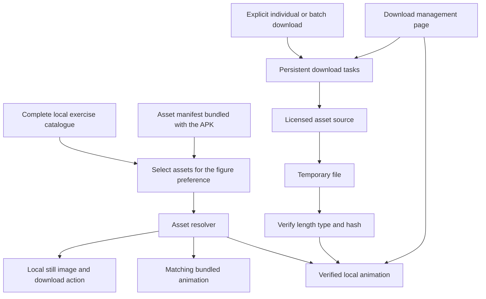

# On-demand Exercise Animations and a Slim APK: Development Design

Date: 2026-10-22

Status (2026-10-24): The initial local implementation, automated validation, and full/slim APKs signed with a test key are complete. The PR is a draft PoC for review. It still needs to be adapted to the newer upstream mobile implementation, production media distribution must be confirmed, and acceptance testing on physical devices remains outstanding. This status does not imply maintainer approval of the media distribution model.

Requirement: [Discussion #744 — Smaller APK with On-Demand Exercise Downloads](https://github.com/DuarteSantos8/openGym/discussions/744)

Code baseline: `e348fc17c42c7e9a211c5972e573ad3698190ee2`. The local checkout and upstream `main` were confirmed to match on that date.

## 1. Goals and Conclusions

Keep the complete exercise catalogue, search, instructions, and workout history, while moving most animations out of the Android installation package and making them available through explicit user downloads. Downloaded animations must remain playable after restarting the app and while offline. Users can download and delete animations in batches, and media management must not change training data.

This is technically feasible: catalogue data and media are already separate, and existing native file storage and verification implementations provide useful reference patterns. A production release requires the maintainers to confirm media licensing, the download source, and maintenance responsibilities. The high-resolution animations currently inside the APK must not simply be uploaded to a public CDN.

The recommended final distribution is a single slim APK with in-app download options. Keep the existing full build during development and the transition; do not automatically change the default release format.

## 2. Verified Baseline

### 2.1 Size Baseline

For the 2026-10-22 design baseline, the GitHub v1.4.1 release's `openGym-1.4.1.apk` was **304,718,274 bytes (304.72 MB)**. This measurement came from the [Release API](https://api.github.com/repos/DuarteSantos8/openGym/releases/latest), whose response changes as releases are published. The fixed release reference is [v1.4.1](https://github.com/DuarteSantos8/openGym/releases/tag/v1.4.1).

The following measurements were taken from the local working tree. All sizes are for unpackaged files, with MB calculated as 1,000,000 bytes:

| Content | Count | Size |
|---|---:|---:|
| `frontend/src/lib/exercises-data.js` | 1 | 1,172,450 bytes / 1.17 MB |
| `catalogue/media/still/*.webp` | 6,554 | 34,820,236 bytes / 34.82 MB |
| `catalogue/media/clip/*.mp4` | 6,554 | 164,340,197 bytes / 164.34 MB |

Asset counts include demonstration figure variants; they are not counts of distinct exercises. The exercise data measurement does not include all translations, instructions, or other application code. The public repository's 180px MP4 files differ from the private 240px WebP animations used in official Android builds, so these figures cannot simply be subtracted to calculate the final APK size.

### 2.2 Code Entry Points

The following paths are relative to the repository root. Proposed new modules are identified below.

| Entry point | Baseline behavior | Implications for this feature |
|---|---|---|
| [catalogue/build.mjs](../../../scripts/catalogue/build.mjs) | Generates exercise and translation data from the catalogue; links variants through aliases | Do not edit generated data by hand or rewrite exercise IDs |
| [stage-media.mjs](../../../scripts/catalogue/stage-media.mjs) | Copies all stills, clips, and NOTICE | Add build modes and manifest validation |
| [frontend/package.json](../../../frontend/package.json) | `build:mobile` builds the app, copies media, and then runs `cap sync` | Isolate Android slim builds from other builds |
| [exercises.js](../../../frontend/src/lib/exercises.js) | `imgSrc` / `gifSrc` construct paths; `figureOf` and `fv` / `mv` select the demonstration | Asset identity must include the actual drawing ID |
| [Media.jsx](../../../frontend/src/components/Media.jsx) | Separates bundled and custom media; falls back to a still image on failure | Connect built-in animations to download state and local asset resolution |
| [main.jsx](../../../frontend/src/main.jsx) | Registers a Service Worker only for non-MOBILE builds | Native builds cannot directly rely on the PWA cache |
| [media-prefetch.js](../../../frontend/src/lib/media-prefetch.js) | Prefetches PWA media for the plan and active workout | Reuse its approach to calculating exercise sets, but not as native storage |
| [media-store-fs.js](../../../frontend/src/lib/media-store-fs.js) | Stores custom media using local files, temporary files, and an index | Follow its file commit and recovery patterns, with a separate directory and lifecycle |
| [media-sync.js](../../../frontend/src/lib/media-sync.js) | Synchronizes and garbage-collects user photos and videos | Built-in assets must not enter this synchronization path |
| [update.js](../../../frontend/src/lib/update.js) | Selects the first APK and first checksum file from a release | Implement exact matching before distributing two APK variants |

The PWA cache currently has limits of 150 MiB and 3,000 entries, with an eviction policy. It cannot guarantee that users can download everything and retain it offline indefinitely. Some older comments still refer to a CDN; the current build code and NOTICE are authoritative.

## 3. Options and Initial Scope

| Option | Benefits | Costs | Decision |
|---|---|---|---|
| One slim APK with in-app downloads | Smaller installation and app updates; retain assets as needed | Requires a download service, asset management, and clearly defined behavior for an initial offline launch | Recommended final approach |
| Separate full / slim production APKs | Preserves the option of complete offline availability from the first launch | Requires maintenance of releases, checksums, updater selection, and upgrades between variants | Adopt only if explicitly requested by the maintainers |
| Keep the full APK and change only encoding or resolution | Smaller implementation change; no new download service | Does not provide selective downloads or reclaim space occupied by unused animations | May be a separate optimization, but does not implement this requirement |

Initial scope:

- Enable the new feature on **Android** only. Preserve existing Web/PWA and iOS behavior.
- Bundle complete metadata, existing translations and text instructions, all 180px static thumbnails, and copyright notices. Do not bundle a curated animation subset in the initial slim build, to avoid maintaining another default exercise list.
- Support tap-to-download for an individual exercise, plus batch actions for the current plan, favourites, and all animations.
- The "current plan" consists of built-in exercises from all `S.routines[].ex[]` plus the active workout's `S.active.entries[]`. "Favourites" come from `S.favEx`. Custom exercises continue using the existing media system.
- For each download, select and deduplicate the actual demonstrations using the current `figureOf(S)`. "All animations" means the animations for the complete built-in exercise catalogue under the current figure preference; it does not download the other figure variant by default.
- Download sets contain only `kind: clip`. Skip unknown and custom exercises. Resolve legacy exercise aliases only when selecting assets, without rewriting user records.
- Each download task is a snapshot of the selected set at the time of the click. Changes to the plan, favourites, or figure preference do not automatically download or delete files. Clicking the corresponding action again recalculates the missing assets.
- All downloads in the initial version require explicit user action. Successfully downloaded content is retained indefinitely and removed only through explicit cleanup or uninstallation. Do not implement automatic LRU eviction.
- The initial version guarantees foreground downloads and task recovery only. It does not promise continuous background execution, per-file HTTP Range resumption, synchronization of download state across devices, or remote manifest updates.
- Add no third-party production dependencies. A code review before implementation on 2026-10-22 found that the existing Filesystem.downloadFile can stream to disk, but cannot expose response status/Retry-After or the final URL, enforce a response size limit, or query available storage. CapacitorHttp passes the complete response into the WebView. To meet the transport contract below, add a project-local Android `CatalogueMediaPlugin` using the platform's HttpURLConnection, MessageDigest, and StatFs, without introducing a third-party plugin. Performance and effort estimates still need to be reassessed after testing on physical devices.

## 4. Release Prerequisites

[NOTICE.md](../../../NOTICE.md#exercise-media-stills-and-animations) states that media in the public repository, website, and self-hosted deployments is limited to 180px. Higher-resolution assets exist only inside compiled app packages. No public API, CDN, or downloadable media package is provided. The code's AGPL license does not cover the animations.

| Prerequisite | Required confirmation | If unmet |
|---|---|---|
| Media licensing | Whether in-app downloads, offline storage, and deletion followed by redownloading are permitted; permitted formats and resolutions | Keep production releases full; use only developer-owned test assets or test assets explicitly permitted for distribution in the PoC |
| Production source | Users without a self-hosted server can access it; responsibility for hosting, bandwidth, and service maintenance is clear | Do not release a default slim package that depends on downloads |
| Access method | Whether the initial download source can lawfully serve assets without user account credentials | If authorization tokens are required, design authentication separately; do not embed a shared long-lived secret |
| Assets for older versions | Retain the immutable files referenced by each manifest throughout the supported lifetime of its app version; publish migration arrangements before removal | Do not publish asset URLs pointing to short-lived CI artifacts |
| Quality | The selected assets loop smoothly on physical devices | Do not assume that repository MP4s are equivalent replacements for the Android WebP animations |

These conditions govern production distribution of real media. They do not prevent development and validation of storage and download flows with test assets. Public availability of the 180px files must not be interpreted as permission to establish another public download service.

## 5. Architecture and Module Boundaries



New files and responsibilities:

| File | Responsibility |
|---|---|
| `scripts/catalogue/build-media-manifest.mjs` | Generate the manifest from actual build inputs; validate paths, formats, coverage, and hashes; support test input directories |
| `frontend/src/lib/catalogue-media-manifest.js` | Read and validate the manifest and build configuration without changing training state |
| `frontend/src/lib/catalogue-media-selection.js` | Pure functions that convert an individual exercise, plan, favourites, or the whole catalogue into deduplicated asset IDs |
| `frontend/src/lib/catalogue-media-store.js` | Local files, indexes, verified commits, startup recovery, and playback reference protection |
| `frontend/src/lib/catalogue-media-native.js`, Android `CatalogueMediaPlugin.java` | A separate native adapter for streaming downloads, response metadata, storage queries, verification, and atomic replacement; allow only same-origin HTTPS redirects and send no account credentials |
| `frontend/src/lib/catalogue-media-download.js` | Deduplicated queue, batches, pause, retry, and progress; download through an injectable transport |
| `frontend/src/lib/catalogue-media.js` | Compose the service and expose state subscriptions, asset resolution, and management operations to components |
| `frontend/src/components/CatalogueMediaManager.jsx` | Batch download and storage management UI, avoiding further growth of the Settings file |

The main integration points are `Media.jsx`, `Settings.jsx`, `main.jsx`, `exercises.js`, build scripts, and Android backup rules. Library already uses media through `Media` / `Thumb`; modify that view only if adding a separate download action there.

Reuse the existing experience with file I/O, hashing, and playback URLs, but do not put built-in assets directly into the existing `mediaStore` singleton. Its pending uploads, account cleanup, and backup semantics belong to user media.

## 6. Manifest and Asset Identity

### 6.1 Bundled Manifest

Generate `exercise-media/manifest.json` in the build output. Do not edit generated data by hand or include private source directories or complete absolute paths in the manifest.

| Field | Type and rules |
|---|---|
| `schemaVersion` | Integer; `1` in the initial version. Unsupported versions disable new downloads while preserving text and still images |
| `catalogueRevision` | Deterministic digest of the catalogue inputs for this build |
| `mediaRevision` | Digest of the sorted asset descriptions; must not depend on generation time |
| `assets` | Array of assets sorted by `assetId`, with unique IDs |
| `assets[].assetId` | `${drawingId}:${kind}:${width}x${height}:${format}`; the logical asset identity |
| `assets[].drawingId` | The actual demonstration ID, preserving leading zeros; distinct from the exercise ID in training records |
| `assets[].kind` | `still` or `clip` |
| `assets[].format` | Initially supports `webp` and `mp4`; MIME type must match the file contents |
| `assets[].width` / `height` | Positive integers from the actual build assets |
| `assets[].bytes` | Actual file length as a positive integer |
| `assets[].sha256` | A 64-character lowercase hexadecimal digest of the file contents |
| `assets[].remotePath` | `objects/<sha256>.<format>`; immutable and relative to the download root |
| `assets[].bundledPath` | Relative path for a bundled asset; `null` when not bundled |

Use `assetId` to select an asset and `sha256` to identify its exact content version and deduplicate files. The initial version has one still and one clip per drawing ID, without resolution negotiation. Manifest validation rejects duplicate IDs, duplicate drawing/kind pairs, directory traversal, absolute paths, invalid extensions, invalid sizes, and conflicting digest/format mappings. Every selectable built-in exercise and figure variant must have corresponding entries.

Ship the manifest inside the signed APK; do not load a "latest manifest" from the network. Remote files must match the bundled digests so that replacing a server file under the same name cannot silently change its contents. Digest verification establishes consistency with that APK's manifest; it does not grant media distribution rights.

The initial download root comes from production build configuration and must be an approved HTTPS source. Do not provide a field for arbitrary URLs or forward Authorization, Cookie, or other account information from the self-hosted API. Redirects must not downgrade to HTTP. The production source should avoid cross-origin redirects, and the transport must verify the actual destination.

### 6.2 Device-local State

On Android, use a separate directory under `Directory.Library`:

```text
opengym-catalogue-media/
  objects/<sha256>.<format>
  staging/<jobId>.part
  index.json
  index.previous.json
  jobs.json
  jobs.previous.json
  generations.json
  generations.previous.json
```

The index records content hashes, formats, lengths, the set of explicitly retained assetIds, verification state, download timestamps, and cancellation generations for cleanup operations. Tasks record batch IDs, manifest versions, asset ID lists, completed sets, states, error codes, and retry counts. They do not store account tokens, training records, or complete plans.

In the implementation, `generations.json` separately stores cancellation generations, content deletion markers, and explicit retention intent, with a previous complete journal retained. This distinguishes a new commit from a cancelled older file even across "cleanup → redownload → crash before the index is persisted". Android file replacement uses native `Os.rename`, without relying on the cross-platform Filesystem overwrite behavior. Commits check batch demand at asynchronous verification, journal, rename, and index persistence boundaries. Downloaded status is published only after the index has been persisted.

Download indexes, batches, and "downloaded" state do not enter `S`, `gym_state_v1`, `/api/data`, or user backup ZIPs. They belong to this device and do not participate in training data merges across devices.

Core interface contract (implemented, with additional helpers for revalidation after playback failure, cleanup of all downloads or obsolete assets, and cancellation on account changes):

```js
selectCatalogueAssets({ state, scope, exerciseIds, manifest })
// scope: 'exercise' | 'plan' | 'favourites' | 'all'
// Returns deduplicated assetId[] in stable sorted order; exerciseIds is used only in exercise mode.

createCatalogueMedia({ manifest, bundledResolver, store, transport })
// Returns a service:
// resolve(assetId) -> Promise<{ status, url, release }>
//   status: 'bundled' | 'downloaded' | 'missing' | 'unavailable'
//   url is null when absent; release() releases the playback reference, without deleting the asset.
// estimate(assetIds) -> Promise<{ missingCount, downloadBytes, peakAdditionalBytes }>
// enqueue(assetIds) -> Promise<{ batchId }>
// pause(batchId) / resume(batchId) / cancel(batchId) -> Promise<void>
// remove(assetIds) -> Promise<{ removedBytes, deferredCount }>
// snapshot() -> { batches, resources, downloadedBytes, bundledBytes }
// subscribe(listener) -> unsubscribe()

transport.download({ url, destination, expectedBytes, onProgress })
// Streams into a temporary file; returns Promise<{ bytesWritten, finalUrl }>.
// Must enforce a response size limit; must not load the entire asset library into JS memory.
// Failures throw a normalized error: { code, status, retryAfterMs, message }.
// code: 'offline' | 'network' | 'timeout' | 'http' | 'no-space'
//     | 'cancelled' | 'redirect' | 'size' | 'type' | 'hash' | 'io'
// status is null for non-HTTP errors; retryAfterMs is null when no valid value exists.
// The network layer supplies status codes and Retry-After; verification/storage use the same error structure.
```

Concurrent requests for the same content hash create only one physical download, with the result shared across batches. Cancelling one batch must not cancel an asset still needed by another batch.

## 7. Loading, downloading and recovery

### 7.1 Display flow

1. Resolve the actual drawing ID from the existing exercise ID and `figureOf(S)`.
2. Prefer a bundled animation that matches the current manifest, then a committed and verified local animation.
3. When no animation is available, show the bundled still image, written instructions and a download button. When offline, explain that the animation can be downloaded once connected; training controls remain usable.
4. Continue routing custom exercises through `CustomMedia`. A missing file must not turn an exercise into an "unknown exercise" or change its training ID.
5. Resolve the asset again when the figure preference changes. If the new figure variant has not been downloaded, show its still image rather than silently displaying the other figure's animation.

Check that a downloaded file exists and has the expected length before reading it; a playback failure triggers revalidation. Revoke the downloaded status of a corrupt file and allow it to be downloaded again. Files from an older manifest may be reused only when their content digest is still referenced by the current manifest; do not assume that old content is compatible.

### 7.2 Download state machine

```text
queued -> downloading -> verifying -> ready
                 |           |
                 +---------> failed -> queued (user retry or limited automatic retry)
queued -> paused -> queued
queued -> cancelled
downloading -> pausing -> paused (finish the current file; do not start the next)
```

Concurrency is fixed at **2** for the first version. Browsing exercises must not download animations automatically. Before a batch download, show the missing count, byte size and selected figure scope. The UI must not present a queued request as available offline; only `ready` assets count as successful downloads.

Download each file to staging first, check the response, length, type and SHA-256, then commit it to its content-addressed path and finally update the index. Index updates use serialized writes, temporary files and a replacement process that retains the previous complete index. Failure at any step must never leave a ready record pointing to a partial file.

Pausing stops new files from being scheduled; the first version does not require an existing Capacitor download to be interrupted immediately. Cancelling a batch also stops new scheduling and assigns a cancellation generation to tasks still transferring. Once cleanup has completed, a download from an older generation must not recommit its file even if it returns later.

For network errors, 408, 429 and 5xx, automatically retry each file at most **2 times**, waiting **2 seconds and 8 seconds**. For 429 with a valid `Retry-After`, honor the longer delay. Do not automatically loop on 401/403/404, invalid formats, incorrect lengths or hash mismatches. Going offline immediately pauses the queue without consuming automatic retries.

When the app enters the background, stop new scheduling and make a best effort to finish files already transferring, without promising that the system will keep the app running. On returning to the foreground or restarting, show batches awaiting recovery and let the user continue them; do not silently start downloading the entire library. For cellular or unknown connection types, batch entry points must clearly warn that the download may use mobile data. A single-exercise button shows the file size, and tapping it expresses the user's intent to download that file.

### 7.3 Crashes and restarts

Recovery order at startup:

1. Validate the current bundled manifest and read the index. If the main index is corrupt, try the previous complete index.
2. Restore any remaining downloading / verifying tasks as paused and remove uncommitted `.part` files.
3. Check the existence and length of files referenced by the index. Entries with missing files must not remain ready.
4. If both indexes are corrupt, scan objects and rebuild the index after matching filenames, lengths and digests against the current manifest. Do not load the entire asset library into memory.
5. If a content file was completed but not recorded in the index, include it after verification. Files that cannot be verified or are no longer referenced by the current manifest are listed only as eligible for cleanup; they do not automatically count as completed downloads.
6. When the user continues a task, skip valid files and download each unfinished file again from the beginning.

If an app upgrade causes a task's `mediaRevision` to differ from the bundled manifest, the old task must not resume directly. Preserve content files that are still valid and match each original drawing ID and kind to the unique asset in the new manifest. Report assets that no longer exist as unavailable, and count assets with changed digests toward the remaining download size. The management page displays the new missing count and download size; resume the batch only after the user confirms.

Recovery support means batch-level recovery; it **does not mean HTTP Range resumption of individual files**.

## 8. Storage space, cleanup and data isolation

- Estimate the total size of missing assets before downloading. Reserve additional space as `total missing asset bytes + bytes of the two largest concurrent files + 16 MiB headroom`; existing files from older versions still count toward current usage.
- The PoC must verify whether the native transport can query available space, enforce download size limits and provide the required response information. If space cannot be queried reliably, show "Space could not be checked" rather than claiming there is enough. A disk write failure must immediately pause the batch and provide an actionable message.
- When downloading a new version of an existing asset, retain the old file until the new file is complete. Do not automatically use the old file as the playback result for the new manifest. At minimum, keep the still image available if downloading fails.
- The management page separately displays bundled media size, downloaded size and the size of old assets eligible for cleanup. Bundled assets cannot be deleted at runtime and must not be included in reclaimable space.
- "Delete selected downloads" removes the explicit retention references for the selected assetIds and stops all batches from requesting those assetIds. Delete a physical file only when no other retention references, batch requests or playback references remain. If another asset still retains a shared file, show the actual reclaimable space as 0 rather than claiming the animation has been removed.
- Cleanup first persists asset cancellation generations, then deletes unreferenced files. Defer deletion of a file currently playing until `release()` and show that its space is awaiting release. Physical-file deletion also records a cancellation generation to prevent older downloads from committing and startup reconciliation from restoring cleaned-up assets. Ordinary batch cancellation removes only that batch's demand; it does not revoke retention references belonging to other batches or completed assets.
- "Delete all downloads" includes obsolete downloaded assets, but excludes bundled thumbnails, custom photos, workout videos and user history. Leave the current plan and favourites unchanged after cleanup.
- Signing out cancels unfinished batches from that session and stops task recovery. Completed public catalogue assets may remain on the device for later use; clearing all app data or uninstalling removes them all.
- Exclude the new directory from cloud-backup in both Android `backup_rules.xml` and `data_extraction_rules.xml` so media does not consume the training-data backup allowance. Device-to-device transfers may retain the files, but startup must still reconcile them. Restoring only a user backup must not imply that assets have been downloaded.

## 9. User interface and copy

Add an "Offline exercise animations" entry in Settings. The management page shows the current figure variant, downloaded count, storage usage, current batch progress and failure count.

| Action | Preview and result |
|---|---|
| Download current plan | Show the scope, missing count and size; list successful and failed counts when complete |
| Download favourites | Process only a snapshot of the current favourites; explain when there are no favourites |
| Download all animations | Make the selected figure scope explicit; show the total count, missing count and storage guidance |
| Pause / Continue / Cancel | Distinguish pausing from paused; cancelling does not delete files already downloaded successfully |
| Retry failed downloads | Requeue only failed assets without requesting valid files again |
| Delete selected downloads / all downloads / old assets | Show the estimated space to be freed; leave plans, favourites and history unchanged |

The single-exercise animation area displays states such as "Download animation · {size}", "Downloading {percent}%", "Not downloaded. Connect to download." and "Download failed. Try again." Do not expose manifests, hashes or file paths to ordinary users.

All new strings use the project's i18n system and must be added to every locale. English strings live in the source code; there is no separate English locale file. Download and error states must be accessible to screen readers, buttons must have clear names, and progress updates must avoid frequent interruptions.

## 10. Building, upgrading and releasing

### 10.1 Build configuration

Implemented build configuration:

| Configuration | Contract |
|---|---|
| `APP_MEDIA_MODE` | `full` or `slim`, defaulting to `full`; the sole input that selects the packaging mode |
| `APP_MEDIA_BASE_URL` | Approved download root URL, passed to the app through the generated manifest/configuration; contains no secrets |
| `APP_MEDIA_DIR` | Retains the existing semantics of the private media input directory; must not appear in the repository or public build logs |

Build order: Vite build → generate the manifest from the actual media inputs and mode → stage the manifest, all still images and selected animations → validate the output → sync the target platform → build and sign with Gradle. Run the generator after Vite clears the output directory so the manifest is not deleted. Generate separate full/slim manifests; each `bundledPath` must match its corresponding output.

The existing `build:mobile` continues to default to full. The new `build:android:slim` uses a separate `dist-android-slim` output directory, a matching Capacitor configuration and `cap sync android`; it does not sync iOS. `check-mobile-bundle.mjs` now accepts a source directory and target platform, rather than assuming every platform can be checked or overwritten together. The Node build entry point supports Windows. A build lock prevents concurrent changes to the Capacitor configuration, and the original configuration is restored even on failure.

Packaging checks must confirm that all metadata and still images are present, every bundled file matches the manifest, slim has no leftover full animations, full contains all animations required by its manifest, NOTICE is retained, and production slim has a valid download source configuration. Pruning must act only on files verified to be inside the specified output directory; it must not delete `catalogue/media` or the private source directory.

The build mode does not change the applicationId, user data path or official signing identity. Android versionCode must increase between successive official releases.

### 10.2 Migration from full to slim

Installing slim over an existing installation replaces the old APK. Animations bundled in the old APK do not automatically become an external download cache. Waiting until slim's first launch to migrate them is too late to read the replaced package.

The first version must not silently switch existing full users to slim. Slim is available only as a clearly marked prerelease or manual test artifact, while official `releases/latest` continues to provide full. Old clients query latest directly; publishing a transitional version first cannot force them to upgrade through every intervening release. Before changing the default release in the future, separately resolve channel compatibility with old updaters and revise this design.

A transitional full version can explain the change to offline animations before launching the installer and offer to save the current plan's animations to a separate directory. Validate and commit migrated files against the current manifest. The user can wait for saving to finish, continue the upgrade and accept still-image fallback, or cancel the upgrade. Reuse cannot be promised when animations from the transitional version do not match the target slim manifest's digests. This feature protects only users who actually installed the transitional version.

Users who skip the transitional version, manually install over the app from the website, or do not save files beforehand can still use the catalogue, still images and training features offline after upgrading, but animations they have not downloaded are unavailable. The download page and release notes must make this clear.

If the maintainer requires full and slim to be publicly available together, both must have explicit, stable asset names and variant identifiers. Update `update.js` to select the APK for the installed variant, then match its `.sha256` by the complete APK filename. Do not put both APKs into the same automatic-update Release until these changes are implemented. Two official packages are not the default deliverable for the first version.

## 11. Development phases and completion criteria

The following work breakdown is part of the design. Each phase delivers an independently reviewable result. Implementations must follow the interface contracts; proposed interfaces in this document must not be treated as existing functionality.

### Phase A: PoC and release prerequisites (approximately 2–4 person-days)

- [ ] Record the licensing decision, permitted asset specifications, source access method and support period. A PoC using test assets can proceed without a licensing decision.
- [ ] Use owned test animations and a fixed test manifest to verify native downloading, validation, local playback and offline playback after closing and reopening the app.
- [x] Assess and record the gaps in the current Capacitor APIs. Use an app-local Android bridge to provide streaming to disk, response size limits, available-space queries, status codes/Retry-After and redirect checks. Java host tests cover the key helper logic; end-to-end verification on a native device remains pending.
- [ ] Verify looping playback of the selected format on a target Android device. Testing must not upload actual restricted media.
- [ ] Build full/slim comparison packages from the same source, toolchain and media encoding; record APK size, installed storage usage and usage after downloading.

Completion criteria: a small sample passes "download → verify → kill process → go offline → play"; failed files are never treated as valid; and any need for further native bridge extensions is understood. Keep full as the default while the prerequisites for distributing actual assets remain unmet.

### Phase B: Manifest and build isolation

Files: proposed `build-media-manifest.mjs` and tests alongside it; changes to `stage-media.mjs`, `frontend/package.json`, `frontend/vite.config.js` and the mobile bundle check script; a new Android slim Capacitor build configuration.

- [x] Add behavior tests for manifest deduplication, variant coverage, content digests, malicious paths and missing assets.
- [x] Implement a deterministic manifest and full/slim modes; the default full build retains every animation.
- [x] Add an Android-specific output directory and sync path. Actually run `cap sync android` and verify that hashes of the entire iOS directory are unchanged before and after.
- [x] Add mode consistency and leftover-file checks; test that building full before slim cannot leave old animations in the new package.

Completion criteria: identical inputs produce an identical manifest; both full and slim outputs pass the checks for their specified platforms; and the original Web and iOS builds remain usable.

### Phase C: Local asset service

Files: proposed `catalogue-media-manifest.js`, `catalogue-media-selection.js`, `catalogue-media-store.js`, `catalogue-media-download.js`, `catalogue-media.js` and their tests; changes to both Android backup XML files.

- [x] Implement storage and queue handling with a fake filesystem and transport covering failures, restarts, concurrent deduplication and cleanup races.
- [x] Implement resolution in bundled / downloaded / still-image order; keep this state out of user sync.
- [x] Implement batch snapshots, estimates, pause/resume, limited retries and explicit deletion.
- [x] Automatically verify recovery from corrupt indexes, reconciliation of missing files, content changes and protection of files currently playing.
- [x] Add cloud-backup exclusions only for the new independent directory; leave training-state backup paths unaffected.

Completion criteria: automated tests cover the failure paths in sections 7–8 of this design; catalogue assets are never uploaded, and user media is never deleted by this service.

### Phase D: Interaction and regression testing

Files: changes to `Media.jsx`, `Settings.jsx`, `main.jsx` and any necessary selection helpers in `exercises.js`; new `CatalogueMediaManager.jsx`, component tests and locale strings.

- [x] Integrate single-exercise downloading and still-image fallback while preserving the existing behavior of `CustomMedia`.
- [x] Implement plan, favourites and whole-library batches and a download management page showing partial failures and recovery states.
- [ ] Check UI behavior in a browser and verify file downloading, foreground/background behavior and offline use on a physical device.
- [x] Automatically cover figure changes, signing out/account switching, plan snapshots, duplicate requests, cleanup during playback and insufficient space.

Completion criteria: the acceptance matrix below passes, and new strings pass the project's locale checks.

### Phase E: Release and migration

Files: depending on the final release decision, changes to `.github/workflows/test.yml`, `.github/workflows/catalogue.yml`, `.gitlab-ci.yml`, `update.js` and its tests; updates to `docs/MOBILE.md`, `docs/FAQ.md` and `CHANGELOG.md`.

- [x] Add the new catalogue scripts to the trigger paths and test commands of the main test and catalogue workflows.
- [ ] Meet the licensing and source prerequisites, and verify that assets referenced by supported older manifests remain downloadable.
- [ ] Prepare transitional messaging and migration verification for full → slim. If both packages are adopted, fix APK/checksum matching first.
- [ ] Retain a reproducible full/slim size report and physical-device acceptance results, and confirm signing and versionCode.

Completion criteria: the publisher confirms that media distribution is available, the upgrade path has explicit offline behavior, and every release artifact is matched to its correct checksum file.

The rough estimate for this Android first version is **1–3 person-weeks**, including the Phase A PoC. This excludes licensing discussions, hosting procurement, background download services and additional complex authentication. It is not a delivery commitment and must be revised after Phase A.

## 12. Acceptance matrix

| Scenario | Required result |
|---|---|
| Go offline immediately after the first slim installation | Full search, written instructions, still images and training records work; animations are clearly marked as not downloaded |
| Download one animation, kill the process and reopen offline | Play from local storage without requesting the remote file; the asset remains marked as downloaded |
| Download the plan, favourites or entire library | Deduplicate assets within the selected figure scope; do not transfer existing valid files again |
| Change the figure preference | Use the correct drawing; fall back to its still image if the new figure variant has not been downloaded; do not change the exercise ID |
| Offline, timeout, 429 or 5xx | Pause or retry a limited number of times according to policy; show partial success; never retry indefinitely |
| 401/403, 404, HTML error page or incorrect hash | Do not commit a ready file; provide an understandable error and allow manual retry |
| Storage fills up during downloading | Pause the batch, remove the current temporary file, and preserve valid downloads and all training data |
| The system kills the app during downloading | Retain verified files after restart; download unfinished files again from the beginning |
| A file was committed but its index entry was not written | Recover it after verification on restart without discarding all existing downloads |
| The index is corrupt or a file has been deleted | Reconcile and repair; do not continue counting missing assets as downloaded |
| Two batches request the same file | Perform one physical download; cancelling one batch does not affect the other |
| Cleanup during playback, or cleanup concurrent with downloading | Never read partial files; delete after release; old tasks must not write back files that have just been cleaned up |
| Remove a favourite or edit a plan | Do not automatically delete downloaded media; training-data changes continue to follow only the existing logic |
| Sign out, switch accounts or restore a user backup | Do not sync download state or upload bundled assets; do not clean up user media or history |
| Upgrade the app with unchanged assets | Reuse files with the same digest without downloading them again; an app upgrade must not clear all downloads |
| Install slim directly over full, then go offline | Make no availability promise for old bundled animations that were not migrated; still images and training work, with consistent explanations |
| Android slim build | No leftover full animations; do not overwrite iOS assets; the default full and Web builds remain usable |
| Automatic updates from the current full build | Continue selecting the correct APK and matching checksum; never switch to slim unintentionally |

### Verification commands

Run the following verification commands from the repository root. See section 14 for actual results and environment limitations. Android builds now use a Node script and no longer depend on POSIX environment-variable syntax.

```powershell
# Existing regression checks
npm --prefix frontend test
npm --prefix frontend run build
node frontend/scripts/check-locales.mjs
node scripts/catalogue/build.mjs --check

# After the proposed new modules are implemented
Push-Location frontend
try {
    npx vitest run src/lib/catalogue-media-manifest.test.js src/lib/catalogue-media-selection.test.js src/lib/catalogue-media-store.test.js src/lib/catalogue-media-download.test.js src/lib/catalogue-media.test.js
} finally {
    Pop-Location
}
node --test scripts/catalogue/build-media-manifest.test.mjs

# After the new build entry point is implemented
npm --prefix frontend run build:android:slim
```

CI must explicitly set Vitest's working-directory to `frontend`; run the manifest generator's Node tests from the repository root.

Measure the size target using comparison packages with the same version, signing method and asset inputs. The initial target is for the slim APK to be **at least 60% smaller** than full. This is a target to verify in the PoC, not a measured conclusion about the current 304.72 MB APK. If the target is not met, first check for duplicate assets, leftover files and still-image usage before deciding whether to reduce the set of bundled images.

## 13. Boundaries that must be preserved in review

This design does not change exercise training semantics, progression calculations or history formats. It does not reduce package size by deleting exercises, turn user media into public assets, or describe a browser's past caching as a guarantee of long-term native offline retention.

Before releasing actual media, the maintainer must make explicit decisions about licensing, the source, retention of historical versions and full → slim migration. Apart from those release decisions, the first version's scope, download semantics, file lifecycle and acceptance criteria are fixed in this document. Development can begin with a PoC using owned test assets.

## 14. Implementation and validation record (2026-10-22)

### 14.1 Delivered

- Deterministic manifests; validation of actual file dimensions, format, length and digest; complete variant coverage; full/slim staging; and an isolated Android build path.
- An app-local Android native bridge providing bounded streaming writes, same-origin HTTPS redirects, response metadata and Retry-After handling, cookie isolation, free-space queries, streaming verification and atomic replacement. No production dependencies were added.
- A separate object store, primary and backup indexes and job files, a cancellation journal, orphan recovery, explicit retention intent for shared content, playback reference protection, and handling of cleanup races.
- Two download lanes, bounded retries, pausing on backgrounding or restart, a new preview after an upgrade, retrying failed items separately, and cancellation of unfinished jobs on sign-out or account changes.
- Single-exercise downloads and still-image fallback; plan, favourites and full-catalogue downloads and storage management in Settings; and complete new copy in all 18 languages. Web/PWA, iOS and custom media retain their existing behavior.
- Catalogue-script triggers and Node tests added to CI; mobile documentation and FAQ updated; and the updater changed to exclude slim preview assets and match checksums by the complete APK filename. A changelog entry was initially prepared, then removed during the PR preparation described in Section 16 to comply with the contribution guidelines; this PR does not include a `CHANGELOG.md` change.

### 14.2 Automated results

| Check | Result and limitations |
|---|---|
| Complete frontend Vitest regression suite | **All 410 files and 5,133 tests passed**. On Windows, UTC and Git's `sh` were used to avoid host-environment dependencies in existing date and container-script tests. |
| Manifest generation and staging Node tests | **8/8 passed**, covering determinism, variants, malicious paths, invalid formats, coverage, full → slim leftovers and file tampering. |
| Android Java helper logic | **6/6 host tests passed**. The production and test classes were compiled with `javac --release 17`, a local Android jar and minimal Capacitor/JUnit stubs. Coverage includes cookies, byte limits, error classification, Retry-After, redirects and formats. This does not constitute a complete Gradle build or device validation. |
| Web production build | Vite build passed. |
| Translations | All 18 locales have the same **2,290** keys; all **1,802** translation strings in the source are covered. |
| Catalogue generation check | Generated data for **5,632** exercises is up to date; no generated training-catalogue data was edited by hand. |
| Manifest generated from actual media | **13,108** entries: 6,554 drawings × still/clip, with no missing figure variants. |
| Actual Android slim build flow | Vite → staging/hash verification → `cap sync android` → bundle checks for the specified output and platform all passed. The original Capacitor configuration was restored byte for byte, and the build lock was removed. |
| iOS isolation | The existing 24 files total 1,109,181 bytes. The directory digest before and after the build was `d061620a9225f3ef68bcc3154b31e5f1ccc1322ffc2324abc1b207065a76bc39`. The previously absent iOS public directory was not created. |
| Diff check | `git diff --check` passed. |

The complete suite was checked locally on Windows with:

```powershell
$env:TZ = 'UTC'
# Add the local Git installation's usr/bin directory to PATH so existing container-script tests can invoke sh.
Push-Location frontend
try { node node_modules/vitest/vitest.mjs run } finally { Pop-Location }
```

Standard CI continues to run `npm test` from the `frontend` directory. Dependencies were ultimately installed offline from the lockfile with install scripts skipped. An external install script for the sharp image-generation tool encountered a certificate issue, but the tests, Vite builds and Capacitor sync were all executed successfully. Certificate verification was not disabled, and the lockfile was not changed.

### 14.3 Local build-directory measurements

The following comparison covers only the generated **uncompressed directories**, using the local public 180px media. The slim configuration uses the non-serving test placeholder root `https://media.example.invalid/`. No media was requested from or uploaded to that address, and this output must not be treated as a distributable release. Small JavaScript changes occurred between the two builds, so this is not a strictly identical-source APK comparison.

| Item | full | Android slim |
|---|---:|---:|
| Build-directory bytes | 227,770,750 | 63,259,804 |
| Still images | 6,554 | 6,554 |
| Bundled animations | 6,554 | 0 |
| Manifest entries | 13,108 | 13,108 |
| NOTICE | Retained | Retained |

The directory size decreased by approximately **72.23%**. Both media inputs have the same `mediaRevision`: `5bacecec897ad6b215ffd0045aee05d3a6e03d39aae45026e425338b04380d41`. This measurement does not establish that the APK-size reduction target of 60% was met, and it does not measure installed size. The complete local report and logs are in the ignored `.tmp/` directory. Future releases should record new, reproducible measurements of the signed packages.

### 14.4 Outstanding release acceptance checks

- The maintainer has not yet confirmed permission for on-demand distribution of the actual media, the production source, access method or historical-version retention period. full remains the default production build.
- Java 21, Gradle 8.11.1 and Android SDK 35 were installed on 2026-10-23. Actual Gradle unit tests and full/slim Release APKs signed with a local test certificate were completed; measurements are in Section 15. In-place upgrades and installed size remain unmeasured. The project's configured toolchain versions were not changed.
- The target Android device has not yet passed the download → verify → kill process → disconnect → play sequence, animation-loop quality checks, low-space checks, foreground/background checks or upgrade migration acceptance. Corresponding unit/component tests cover these scenarios, but they do not replace device results.
- The browser tool was not authorized to access the local acceptance-test address, so no manual browser interaction or visual acceptance check was performed. Automated interaction tests of the actual components were completed; no alternative browser interface was used to bypass the restriction.
- No APK was published, no public media-download service was established, and no restricted animation was uploaded. A future default switch and the full → slim transition mechanism still require separate review. At this stage, only manual test builds and clear documentation of still-image fallback are provided.

## 15. APK measurements from identical source (2026-10-23)

### 15.1 Measurement scope

The same workspace source and the same existing repository **180px MP4 animations and accompanying still images** were used to generate the full/slim Web inputs and build Android Release APKs. Both APKs were signed with the same local test certificate. Both are version **1.4.1 (versionCode 26)**, include **arm64-v8a and armeabi-v7a**, use minSdk 23 and targetSdk 35, and retain the project's existing `minifyEnabled false` setting.

The toolchain was Microsoft OpenJDK **21.0.12.1**, Gradle **8.11.1**, Android Gradle Plugin **8.7.2** and Android SDK Platform **35**. Alignment and signing used zipalign/apksigner from Build-Tools **35.0.0**. The project's Gradle, AGP and SDK version configuration was not changed.

The input fingerprint covering frontend and Java source, catalogue scripts and key build configuration was identical before and after input preparation and after both APKs were completed:

```text
7881814a31e6fdb466f4eda928dd1c7170d8fab349bd7c21060f504df4fba650
```

Both manifests have `mediaRevision` `5bacecec897ad6b215ffd0045aee05d3a6e03d39aae45026e425338b04380d41` and `catalogueRevision` `131f1726daa15d54d4658ca188d48f4f97ba8b2e44e71ed413769963f8bd65da`.

### 15.2 Actual package sizes

| Item | full | Android slim |
|---|---:|---:|
| Signed APK bytes | **222,869,835** | **56,916,631** |
| Signed APK MB | **222.87** | **56.92** |
| Unsigned APK bytes | 221,746,696 | 56,324,008 |
| Web input-directory bytes for this measurement | 227,772,562 | 63,260,252 |
| Still images in the APK | 6,554 | 6,554 |
| Bundled animations in the APK | 6,554 | 0 |
| Manifest entries | 13,108 | 13,108 |
| NOTICE | Retained | Retained |

MB means **1,000,000 bytes**. The signed slim APK is **165,953,204 bytes, or 165.95 MB (74.46%)**, smaller than full. This input set meets the PoC target of at least a 60% reduction. The total compressed size of the still images in each APK is **34,820,236 bytes**; the animations bundled in full total **164,340,197 bytes**.

These results measure APK file size. Installed size, user data and subsequent download caches must be measured separately on the target device. Production 240px WebP media inputs also require separate measurements; these results cannot be applied directly to the historical 304.72 MB release APK.

### 15.3 Validation results and artifacts

- Actual Gradle `:app:assembleRelease` builds succeeded for both full and slim, and Release lint checks passed.
- The actual Gradle `:app:testDebugUnitTest` run passed **14/14 tests, with no skips, failures or errors**. This includes **6/6** tests in `CatalogueMediaTransportTest`, extending the validation in Section 14.2 beyond host compilation with stubs.
- Both APKs passed v1/v2/v3 signature verification and post-signing 16 KB native-library ZIP alignment checks. Package name, version, SDK settings and ABIs are identical.
- Reading the manifests and resource counts from the final APKs confirmed that full retains all animations, slim bundles no animations, and both retain the still images and NOTICE.
- The original Capacitor configuration was restored byte for byte, `webDir` returned to `dist`, and the build lock was removed. Digests of the four native-toolchain configuration files were unchanged before and after the builds.

Local artifacts and machine-readable reports are stored in the Git-ignored `.tmp/apk-size/` directory:

```text
openGym-full-size-check.apk
SHA-256: 0dcc99c7e8330a14d8adfeb2e9b51c6ee8f01ec3675b36c9b063db9dcb430350

openGym-slim-size-check.apk
SHA-256: 7d9ecf51b9283ff8bb809a55d558486ce8611ea871128442c8ed2b314be69c7f

report-inputs.json
report-apks.json
android-tests.json
```

Both APKs use the **openGym Local Size Check local test signing certificate** and cannot directly replace an installation signed with the official certificate. The slim media root remains the non-serving placeholder `https://media.example.invalid/`; remote animation downloads are not connected to a production source. No media was downloaded or uploaded during this measurement. Production distribution permission, the media service, and device acceptance for offline playback, low space, foreground/background behavior and upgrade migration remain outstanding as described in Section 14.4. full remains the default production build.

## 16. PR preparation checks (2026-10-24)

A read-only pre-review identified a crash window in the shared cache: if the process exits after the retention journal records the cleanup of A but before the index is updated, the old index restores the shared references for A and B, preventing a later cleanup of B from freeing the file. Recovery now reconciles the index against the latest retention journal. Resource IDs are normalized after validation when the manifest changes, while legacy indexes without a retention journal remain supported.

Four regression cases were added for the primary index, backup index, legacy journal and shared-resource upgrades. After the fix, the complete frontend regression suite passed **410 files and 5,137 tests**, including **24/24** storage tests. The manifest Node tests passed **8/8**; the Web production build, checks for all 18 languages and catalogue generation checks also passed.

The APKs measured in Section 15 were built before this recovery fix. Their sizes and digests correspond to the input fingerprint recorded there. A production candidate must rebuild the APKs and complete device acceptance.

The implementation was developed from `e348fc17` (v1.4.1). By the time the PR was prepared, upstream `main` had moved to Capacitor 8 and added Standard / Plus / HD APKs and animation-quality download integration. This branch is a PoC draft for design and implementation review. Before merging, additional commits must integrate the latest `main`, preserve its APK variant selection, `useAnimSources` and platform-specific media-delivery paths, and revalidate the mobile builds. Production media permission and sourcing, manual browser acceptance and device acceptance are still outstanding.

The changelog changes prepared earlier were removed during PR preparation in accordance with the contribution guidelines; `CHANGELOG.md` is not included in this PR.
