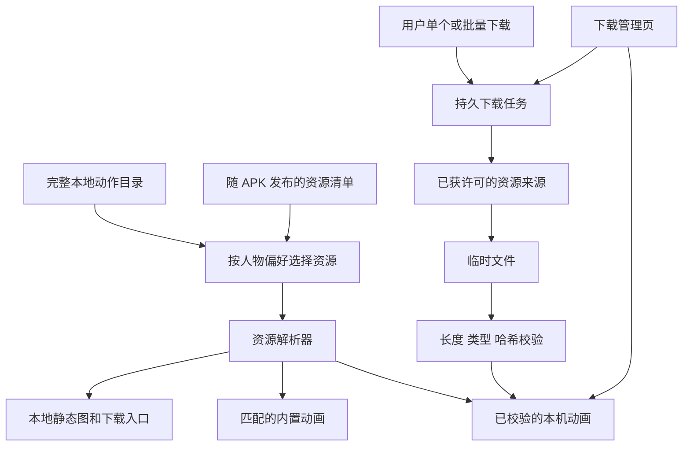

# 动作动画按需下载与轻量 APK：开发设计

日期：2026-10-22

状态（2026-10-24）：首版本地实现、自动化验证及 full/slim 测试签名 APK 已完成；PR 作为 PoC 草稿评审，仍需适配上游新移动端实现、确认正式媒体分发并完成真机验收，不代表维护者已批准媒体分发方式。

需求：[Discussion #744 — Smaller APK with On-Demand Exercise Downloads](https://github.com/DuarteSantos8/openGym/discussions/744)

代码基线：`e348fc17c42c7e9a211c5972e573ad3698190ee2`，当日核对本地与上游 `main` 一致。

## 1. 目标与结论

保留完整动作目录、搜索、说明和训练历史，将 Android 安装包中的大部分动画改为用户主动下载。下载后的动画在重启和断网后仍可播放，用户可以批量下载与删除，媒体管理不改变训练数据。

技术上可行，现有目录与媒体已分离，原生文件存储和校验也有可参考实现。正式发行的前提是维护者确认媒体许可、下载来源和维护责任；不能把当前 APK 内的高分辨率动画直接上传到公共 CDN。

推荐最终发行形态为一个轻量 APK，App 内提供下载选项。开发和过渡期保留现有 full 构建，默认发行方式不自动切换。

## 2. 已核实的现状

### 2.1 体积基线

GitHub 当前最新版本 v1.4.1 的 `openGym-1.4.1.apk` 为 **304,718,274 bytes（304.72 MB）**。数据来自 [Release API](https://api.github.com/repos/DuarteSantos8/openGym/releases/latest)，该端点会随发行变化；对应固定版本为 [v1.4.1](https://github.com/DuarteSantos8/openGym/releases/tag/v1.4.1)。

本地工作树实测，以下均为未打包文件大小，MB 按 1,000,000 bytes 计算：

| 内容 | 数量 | 大小 |
|---|---:|---:|
| `frontend/src/lib/exercises-data.js` | 1 | 1,172,450 bytes / 1.17 MB |
| `catalogue/media/still/*.webp` | 6,554 | 34,820,236 bytes / 34.82 MB |
| `catalogue/media/clip/*.mp4` | 6,554 | 164,340,197 bytes / 164.34 MB |

资源数量包含人物示范变体，并非独立动作数。动作主数据大小不含全部翻译、说明及其他应用代码。公开仓库的 180px MP4 与官方 Android 构建使用的私有 240px WebP 动画不同，不能用上述数值直接减出最终 APK 大小。

### 2.2 代码入口

以下路径相对仓库根目录；新增模块将在后文明确标为“拟新增”。

| 入口 | 当前行为 | 对本功能的影响 |
|---|---|---|
| [catalogue/build.mjs](../../../scripts/catalogue/build.mjs) | 从 catalogue 生成动作和翻译数据；变体通过别名关联 | 不手改生成数据，不重写动作 ID |
| [stage-media.mjs](../../../scripts/catalogue/stage-media.mjs) | 全量复制 still、clip 和 NOTICE | 增加构建模式与清单校验 |
| [frontend/package.json](../../../frontend/package.json) | `build:mobile` 构建、复制媒体，再执行 `cap sync` | 必须隔离 Android slim 与其他构建 |
| [exercises.js](../../../frontend/src/lib/exercises.js) | `imgSrc` / `gifSrc` 拼接路径，`figureOf` 和 `fv` / `mv` 选择示范 | 资源身份必须包含实际 drawing ID |
| [Media.jsx](../../../frontend/src/components/Media.jsx) | 内置媒体与自定义媒体分开；失败时回退静态图 | 为内置动画接入下载状态与本地解析 |
| [main.jsx](../../../frontend/src/main.jsx) | 只有非 MOBILE 构建注册 Service Worker | 原生端不能直接使用 PWA 缓存 |
| [media-prefetch.js](../../../frontend/src/lib/media-prefetch.js) | PWA 按计划和进行中训练预取媒体 | 可参考动作集合计算，不能直接作为原生存储 |
| [media-store-fs.js](../../../frontend/src/lib/media-store-fs.js) | 自定义媒体用本机文件、临时文件和索引保存 | 参考文件提交与恢复方式，使用独立目录和生命周期 |
| [media-sync.js](../../../frontend/src/lib/media-sync.js) | 同步、回收用户照片和视频 | 内置资源不能进入这条同步链路 |
| [update.js](../../../frontend/src/lib/update.js) | 取 Release 中第一个 APK 和第一个校验文件 | 双包发行前必须改为准确匹配 |

PWA 当前缓存上限为 150 MiB、3,000 项，并有淘汰策略，不能作为“下载全部并长期离线保留”的保证。部分旧注释仍提到 CDN，应以当前构建代码和 NOTICE 为准。

## 3. 方案比较与首版范围

| 方案 | 优点 | 代价 | 取舍 |
|---|---|---|---|
| 单一 slim APK + App 内下载 | 安装和应用更新更小；资源按需保留 | 需要下载服务、资源管理及明确的首次离线体验 | 推荐最终方案 |
| full / slim 两种正式 APK | 用户可保留首次启动即全离线的选择 | 发布、校验、更新器和跨变体升级都要维护 | 仅在维护者明确要求时采用 |
| 保持 full APK，仅调整编码或分辨率 | 改动较小，不新增下载服务 | 无法满足选择下载和释放未用动画空间 | 可作独立优化，不作为本需求的实现 |

首版约定：

- 只在 **Android** 开放新功能；Web/PWA 和 iOS 保持原有行为。
- 内置完整元数据、现有翻译与文字说明、全部 180px 静态缩略图和版权说明。首版不内置精选动画，避免另维护一个默认动作名单。
- 单动作点按下载；批量入口包括当前计划、收藏、全部动画。
- “当前计划”指全部 `S.routines[].ex[]` 加进行中 `S.active.entries[]` 的内置动作；“收藏”来自 `S.favEx`；自定义动作继续走原有媒体系统。
- 每次下载按当前 `figureOf(S)` 选择实际示范并去重。“全部动画”是当前人物偏好下完整内置动作目录的动画集合，不默认下载另一人物版本。
- 下载集合只包含 `kind: clip`。不存在的动作和自定义动作被跳过；旧动作别名仅在资源选择时解析，不回写用户记录。
- 下载任务是点击时的集合快照。计划、收藏或人物偏好变化不会自动下载或删除文件；再次点击相应入口会计算缺少的资源。
- 首版所有下载均为显式操作，下载成功的内容长期保留，只有明确清理或卸载才移除；不实现 LRU 自动淘汰。
- 首版只保证前台下载和任务恢复，不承诺后台持续运行、单文件 HTTP Range 续传、跨设备同步下载状态或远程热更新 manifest。
- 不新增生产第三方依赖。2026-10-22 实现前代码核查发现，现有 Filesystem.downloadFile 只能流式落盘，不能提供响应状态/Retry-After、最终 URL、超额响应限制及可用空间查询；CapacitorHttp 则会将完整响应传入 WebView。为满足下述 transport 契约，增加项目内 Android `CatalogueMediaPlugin`，使用系统 HttpURLConnection、MessageDigest 和 StatFs；不引入第三方插件。真机性能与工期仍需在实际设备验证后复核。

## 4. 发行前置条件

[NOTICE.md](../../../NOTICE.md#exercise-media-stills-and-animations) 说明：公开仓库、网站和自托管媒体最多 180px；更高分辨率资源仅存在于编译后的 App 包内；没有开放公共 API、CDN 或媒体下载包。动画不属于代码的 AGPL 授权范围。

| 条件 | 必须确认的内容 | 条件不满足时 |
|---|---|---|
| 媒体许可 | App 内按需下载、离线保存及删除重下是否允许；允许的格式和分辨率 | 正式发行继续 full；PoC 只使用开发者自有或明确允许分发的测试资源 |
| 正式来源 | 无自托管服务器的用户也能访问；托管、带宽和服务维护责任明确 | 不发布依赖下载的默认 slim 包 |
| 访问方式 | 首版下载源能否在不携带用户账号凭据的情况下合法提供资源 | 如需要授权令牌，另行设计认证流程，不能嵌入长期共享密钥 |
| 历史版本资源 | 在仍受支持的 App 版本生命周期内保留其 manifest 引用的不可变文件；下架前公开迁移安排 | 不允许发布指向短期 CI artifacts 的资源 URL |
| 质量 | 选定资源在真机上循环播放流畅 | 不默认把仓库 MP4 当作 Android WebP 的等价替代 |

这些条件限制真实媒体上线，不阻止使用测试资源开发、验证存储和下载流程。公开 180px 文件也不能被自动解释为可重新建立公共下载服务的许可。

## 5. 架构与模块边界



新增文件及责任：

| 文件 | 责任 |
|---|---|
| `scripts/catalogue/build-media-manifest.mjs` | 从实际构建输入生成清单；验证路径、格式、覆盖率和哈希；支持测试输入目录 |
| `frontend/src/lib/catalogue-media-manifest.js` | 读取、验证清单与构建配置；不修改训练状态 |
| `frontend/src/lib/catalogue-media-selection.js` | 纯函数：将单动作、计划、收藏、全目录转换为去重的资源 ID |
| `frontend/src/lib/catalogue-media-store.js` | 本机文件、索引、校验提交、启动恢复和播放引用保护 |
| `frontend/src/lib/catalogue-media-native.js`、Android `CatalogueMediaPlugin.java` | 独立的原生流式下载、响应信息、空间查询、校验和原子替换适配；同源 HTTPS 跳转，不传账号凭据 |
| `frontend/src/lib/catalogue-media-download.js` | 去重队列、批次、暂停、重试、进度；通过可注入 transport 下载 |
| `frontend/src/lib/catalogue-media.js` | 组合服务；向组件提供状态订阅、资源解析和管理操作 |
| `frontend/src/components/CatalogueMediaManager.jsx` | 批量下载和空间管理 UI，避免继续扩大 Settings 文件 |

主要修改入口：`Media.jsx`、`Settings.jsx`、`main.jsx`、`exercises.js`、构建脚本与 Android 备份规则。Library 已通过 `Media` / `Thumb` 使用媒体，只有新增其独立下载入口时才修改该视图。

复用文件读写、哈希和播放 URL 的实现经验，不把内置资源直接塞进现有 `mediaStore` 单例。现有单例的 pending 上传、账号清理和备份语义属于用户媒体。

## 6. 清单与资源身份

### 6.1 随包清单

生成位置为构建产物 `exercise-media/manifest.json`，不手工修改生成数据，不将私有源目录或完整绝对路径写入清单。

| 字段 | 类型与规则 |
|---|---|
| `schemaVersion` | 整数，首版为 `1`；不支持的版本禁用新下载，保留文字和静态图 |
| `catalogueRevision` | 本次 catalogue 构建输入的确定性摘要 |
| `mediaRevision` | 排序后的资源描述集合摘要；不能依赖生成时间 |
| `assets` | 资源数组，按 `assetId` 排序，ID 唯一 |
| `assets[].assetId` | `${drawingId}:${kind}:${width}x${height}:${format}`，逻辑资源身份 |
| `assets[].drawingId` | 实际示范 ID，保留前导零；不等同于训练记录的 exercise ID |
| `assets[].kind` | `still` 或 `clip` |
| `assets[].format` | 首版允许 `webp`、`mp4`；MIME 与文件内容一致 |
| `assets[].width` / `height` | 正整数，来自实际构建资源 |
| `assets[].bytes` | 实际文件长度，正整数 |
| `assets[].sha256` | 文件内容的 64 位小写十六进制摘要 |
| `assets[].remotePath` | `objects/<sha256>.<format>`，相对下载根路径；不可变 |
| `assets[].bundledPath` | 内置资源的相对路径；未内置时为 `null` |

`assetId` 用于选择资源，`sha256` 用于判断具体版本与文件去重。首版每个 drawing ID 各有一个 still 和一个 clip，不做多清晰度协商。清单验证拒绝重复 ID、重复 drawing/kind、目录穿越、绝对路径、非法扩展名、无效大小以及矛盾的摘要/格式映射。所有实际可选的内置动作和人物变体必须有相应条目。

清单随已签名 APK 发布，不从网络加载“最新清单”。远端文件必须与随包摘要一致，避免服务端同名替换悄悄改变内容。摘要验证保证与该 APK 清单一致，不代表取得媒体分发授权。

首版下载根地址来自正式构建配置，必须为获批的 HTTPS 来源，不提供任意 URL 输入框，不转发自托管 API 的 Authorization、Cookie 或其他账号信息。重定向不得降级到 HTTP；正式来源应避免跨来源跳转，transport 必须验证实际目标。

### 6.2 设备本地状态

Android 使用 `Directory.Library` 下独立目录：

```text
opengym-catalogue-media/
  objects/<sha256>.<format>
  staging/<jobId>.part
  index.json
  index.previous.json
  jobs.json
  jobs.previous.json
  generations.json
  generations.previous.json
```

索引记录内容哈希、格式、长度、显式保留的 assetId 集合、校验状态和下载时间，以及清理操作的取消代次。任务记录批次 ID、清单版本、资源 ID 列表、已完成集合、状态、错误码与重试次数；不保存账号令牌、训练记录或完整计划。

实现中 `generations.json` 独立保存取消代次、内容删除标记和显式保留意图，并保留上一份完整日志；这使“清理 → 重新下载 → 索引落盘前崩溃”仍能区分新提交和已取消的旧文件。Android 文件替换使用原生 `Os.rename`，不依赖跨平台 Filesystem 的覆盖行为。提交在异步校验、日志、重命名和索引保存边界检查批次需求；只有索引持久化完成后才发布已下载状态。

下载索引、批次和“已下载”状态不进入 `S`、`gym_state_v1`、`/api/data` 或用户备份 ZIP。它们属于本设备，不触发多设备训练数据合并。

核心接口约定（已实现；另提供播放失败复核、清理全部/旧资源与账号切换取消辅助接口）：

```js
selectCatalogueAssets({ state, scope, exerciseIds, manifest })
// scope: 'exercise' | 'plan' | 'favourites' | 'all'
// 返回去重且稳定排序的 assetId[]；exerciseIds 只在 exercise 模式使用。

createCatalogueMedia({ manifest, bundledResolver, store, transport })
// 返回服务：
// resolve(assetId) -> Promise<{ status, url, release }>
//   status: 'bundled' | 'downloaded' | 'missing' | 'unavailable'
//   url 缺失时为 null；release() 释放播放引用，不删除资源。
// estimate(assetIds) -> Promise<{ missingCount, downloadBytes, peakAdditionalBytes }>
// enqueue(assetIds) -> Promise<{ batchId }>
// pause(batchId) / resume(batchId) / cancel(batchId) -> Promise<void>
// remove(assetIds) -> Promise<{ removedBytes, deferredCount }>
// snapshot() -> { batches, resources, downloadedBytes, bundledBytes }
// subscribe(listener) -> unsubscribe()

transport.download({ url, destination, expectedBytes, onProgress })
// 流式写入临时文件；返回 Promise<{ bytesWritten, finalUrl }>。
// 必须限制超额响应；不将整个资源库加载到 JS 内存。
// 失败抛出统一错误：{ code, status, retryAfterMs, message }。
// code: 'offline' | 'network' | 'timeout' | 'http' | 'no-space'
//     | 'cancelled' | 'redirect' | 'size' | 'type' | 'hash' | 'io'
// status 非 HTTP 错误时为 null；retryAfterMs 无有效值时为 null。
// 网络层提供状态码与 Retry-After；校验/存储层使用同一错误结构。
```

同一内容哈希的并发请求只创建一次物理下载；多个批次共享结果。取消一个批次不能取消其他批次仍需要的资源。

## 7. 加载、下载与恢复流程

### 7.1 显示流程

1. 根据原有动作 ID 与 `figureOf(S)` 得到实际 drawing ID。
2. 优先使用与当前清单匹配的内置动画，其次使用已提交且校验通过的本机动画。
3. 没有动画时展示内置静态图、文字说明和下载按钮；无网络时说明可联网后下载，训练操作仍可使用。
4. 自定义动作继续交给 `CustomMedia`。文件缺失不将动作变成“未知动作”，不变更训练 ID。
5. 切换人物偏好重新解析资源；新示范未下载时显示静态图，不静默展示另一人物动画。

读取已下载文件时检查其存在与长度；播放失败触发重新校验。损坏文件撤销“已下载”状态并允许重下。旧清单文件只有内容摘要仍被当前清单引用时才可复用，不猜测旧内容兼容性。

### 7.2 下载状态机

```text
queued -> downloading -> verifying -> ready
                 |           |
                 +---------> failed -> queued（用户重试或有限自动重试）
queued -> paused -> queued
queued -> cancelled
downloading -> pausing -> paused（当前文件处理完，不开始下一个）
```

首版并发数固定为 **2**。浏览动作不会自动下载动画；批量下载前显示缺少数量、字节数与当前人物范围。UI 不把“请求已入队”显示为“已离线可用”，只有 `ready` 才计入成功数量。

每个文件先下载到 staging，检查响应、长度、类型与 SHA-256，再提交到内容寻址文件路径，最后更新索引。更新索引采用串行写入、临时文件、保留上次完整索引的替换流程。任何步骤失败都不能留下指向半个文件的 ready 记录。

暂停停止新文件调度；首版不要求现有 Capacitor 下载立即中断。取消批次同样停止新调度，对仍在传输的任务设置取消代次。清理完成后，旧代次下载即使稍后返回，也不能重新提交文件。

对网络错误、408、429、5xx，每个文件最多自动重试 **2 次**，等待 **2 秒、8 秒**；429 有合法 `Retry-After` 时服从更长的等待。401/403/404、格式错误、长度错误和哈希不符不自动循环重试。离线立即暂停队列，不消耗自动重试次数。

App 进入后台时停止新调度，对正在传输的文件尽力完成，但不承诺系统继续执行。重新进入前台或重启后显示待恢复批次，由用户继续；不偷偷开始全库下载。蜂窝网络或连接类型未知时，批量入口明确提醒可能使用移动数据；单动作按钮展示大小，点击即代表本次下载意图。

### 7.3 崩溃与重启

启动恢复顺序：

1. 验证当前随包清单；读取索引，主索引损坏时尝试上次完整索引。
2. 将残留 downloading / verifying 任务恢复为暂停状态，清理未提交 `.part` 文件。
3. 对索引引用的文件检查存在与长度；缺失的记录不能继续标为 ready。
4. 索引均损坏时扫描 objects，按当前清单匹配文件名、长度和摘要后重建；不加载整个资源库到内存。
5. 内容文件已完成但索引未写入的情况，经过校验后收录；无法验证或不再被当前清单引用的文件仅列为可清理，不自动算作下载完成。
6. 用户继续任务时跳过有效文件，未完成的单个文件从头重下。

App 升级导致任务的 `mediaRevision` 与随包清单不同，旧任务不得直接继续。保留仍有效的内容文件，按原任务的 drawing ID 和 kind 匹配新清单的唯一资源；已不存在的资源报告为不可用，摘要变更的资源重新计入待下载大小。管理页展示新的缺少数量和下载大小，用户确认继续后才恢复该批次。

“支持恢复”指批次级恢复，**不等于单文件断点续传**。

## 8. 空间、清理与数据隔离

- 下载前估算缺少资源的总大小。额外空间按 `缺少资源总字节 + 并发中最大两个文件字节 + 16 MiB 余量` 预留；已存在的旧版本文件仍计入当前占用。
- PoC 验证当前 native transport 是否能提供可用空间查询、超额下载限制和所需响应信息。不能可靠查询时显示“空间无法预检”，不伪报足够；磁盘写入失败必须立即暂停批次并给出可操作提示。
- 下载旧资源的新版本时，旧文件在新文件完成前保留。旧文件不自动作为新清单的播放结果；失败时至少保持静态图可用。
- 管理页分别显示随包媒体大小、已下载大小和可清理旧资源大小。内置资源不能在运行时删除，不能把它们计入“可释放空间”。
- “清理所选”移除选中 assetId 的显式保留引用，并停止所有批次对这些 assetId 的需求。实体文件只有在没有其他保留引用、批次需求及播放引用时才删除；共享文件仍被其他资源保留时，页面显示实际可释放为 0，而不是声称动画已移除。
- 清理先持久记录资源取消代次，再删除无引用文件；播放中的文件延迟到 `release()` 后删除，页面显示待释放状态。实体级删除也记录取消代次，阻止旧下载提交和启动对账把已清理资源重新恢复。普通批次取消只移除该批次需求，不撤销其他批次或已完成资源的保留引用。
- “清理全部下载”包括过期下载资源，不包含随包缩略图、自定义照片、训练视频或用户历史。清理后当前计划与收藏保持原样。
- 退出账号取消该次使用期间尚未完成的批次，停止任务恢复；已完成的公共目录资源可留在设备供下次使用，清除全应用数据或卸载才全部删除。
- Android `backup_rules.xml` 和 `data_extraction_rules.xml` 的 cloud-backup 都排除新目录，避免媒体挤占训练数据备份额度。设备间迁移可以保留文件，但启动时仍重新对账；仅恢复用户备份时不得假装资源已下载。

## 9. 用户界面与文案

设置中增加“离线动作动画”入口，管理页展示：当前人物示范、已下载数量、占用大小、当前批次进度和失败数量。

| 操作 | 预览与结果 |
|---|---|
| 下载当前计划 | 显示范围、缺少数量和大小；完成后列出成功与失败数量 |
| 下载收藏 | 只处理当前收藏快照；没有收藏时解释原因 |
| 下载全部动画 | 明确当前人物范围；显示总量、缺少量及空间提示 |
| 暂停 / 继续 / 取消 | 暂停中与已暂停区分；取消不删除已成功的文件 |
| 重试失败项 | 只重新入队失败资源，不重复请求有效文件 |
| 清理所选 / 全部下载 / 旧版本资源 | 显示预计释放空间；不改变计划、收藏和历史 |

单动作动画区域显示“下载动画 · {size}”“下载中 {percent}%”“未下载，联网后可下载”“下载失败，重试”等状态。不要显示 manifest、hash 或文件路径给普通用户。

所有新字符串使用项目 i18n 并补齐所有 locale；英文是源码字符串，没有独立英文语言文件。下载和错误状态需可被屏幕阅读器识别，按钮有明确名称，进度更新避免频繁打断。

## 10. 构建、升级与发布

### 10.1 构建配置

已实现的构建配置：

| 配置 | 约定 |
|---|---|
| `APP_MEDIA_MODE` | `full` 或 `slim`，默认 `full`；作为打包模式的唯一输入 |
| `APP_MEDIA_BASE_URL` | 获批下载根地址；通过生成清单/配置传入 App，不包含秘密 |
| `APP_MEDIA_DIR` | 延续现有私有媒体输入目录语义；不进入仓库或公开构建日志 |

构建顺序：Vite 构建 → 根据实际媒体输入和模式生成 manifest → staging 同时放入 manifest、完整静态图及选定动画 → 校验产物 → 同步目标平台 → Gradle 构建与签名。生成器在 Vite 清空输出目录之后运行，避免清单被删；full/slim 各自生成清单，`bundledPath` 必须与各自产物一致。

现有 `build:mobile` 默认继续 full。新增 `build:android:slim`，使用独立 `dist-android-slim` 构建目录、匹配的 Capacitor 配置和 `cap sync android`，不同步 iOS。`check-mobile-bundle.mjs` 已扩展为可指定源目录和目标平台；不能沿用“全部平台一起检查/覆盖”的隐含假设。Node 构建入口兼容 Windows；构建锁阻止并行修改 Capacitor 配置，失败时也恢复原配置。

打包校验必须确认：全部元数据与静态图存在；每个随包文件与清单匹配；slim 中没有遗留 full 动画；full 中清单所需动画齐全；NOTICE 保留；生产 slim 的下载源配置有效。裁剪只作用于已校验位于指定输出目录内的文件，不能删除 `catalogue/media` 或私有源目录。

构建模式不改变 applicationId、用户数据路径或正式签名身份。相邻正式版本的 Android versionCode 保持递增。

### 10.2 full 到 slim 的迁移

覆盖安装 slim 会替换旧 APK，旧包内动画不会自动变成外部下载缓存。仅在 slim 首次启动时做迁移已经来不及读取被替换的旧包。

首版不对现有 full 用户静默切换：slim 仅作为明确标记的预发布或手动测试产物，正式 `releases/latest` 继续提供 full。旧客户端直接查询 latest，不能依赖“先发布过渡版本”强制它们逐版升级；未来切换默认发行前，必须另行解决旧更新器的通道兼容并修订此方案。

full 过渡版本可以在安装器启动前明确告知离线动画变化，并提供“保存当前计划动画到独立目录”的选项。迁移过程按当前清单校验与提交，用户可以等待保存完成、继续升级并接受静态图回退，或取消升级。过渡版本来源动画与目标 slim 清单摘要不一致时不能承诺复用；该功能只保障实际安装了过渡版本的用户。

跳过过渡版本、从网站手工覆盖安装或没有提前保存的用户，升级后离线仍能使用目录、静态图和训练功能，但未下载动画不可用；下载页和发布说明必须清楚表达这一点。

若维护者要求同时公开 full/slim，两者必须有明确且稳定的资产命名与变体标记，并修改 `update.js` 为“选择本变体 APK，再按完整 APK 文件名匹配 `.sha256`”。未实现这些改动前，不能把两个 APK 放进同一自动更新 Release。首版不把双正式包作为默认交付。

## 11. 分阶段开发与完成条件

以下是设计内的工作分解。每阶段交付可单独评审的结果；具体实现应遵循接口契约，不把文档中的拟新增接口当作已有功能。

### 阶段 A：PoC 和发行条件核实（约 2–4 人日）

- [ ] 记录许可结论、允许的资源规格、来源访问方式和支持期限；没有许可结论也可继续测试资源 PoC。
- [ ] 用自有测试动画和固定测试清单，验证原生下载、校验、本地播放和关闭重开后的离线播放。
- [x] 核查并记录当前 Capacitor API 的能力差距；用项目内 Android 桥接补足流式落盘、超额响应限制、空间查询、状态码/Retry-After 和跳转检查，Java 主机测试已覆盖关键辅助逻辑。原生设备上的端到端验证仍待完成。
- [ ] 在目标 Android 真机验证选定格式循环播放；测试资源不得上传实际受限媒体。
- [ ] 构建同源码、同工具链、同资源编码的 full/slim 对照包，记录 APK、安装占用及下载后的占用。

完成条件：小样本完成“下载 → 校验 → 杀进程 → 断网 → 播放”，失败文件不会被当成有效文件；明确后续是否需要原生桥接扩展。实际资源发行条件未满足时，保持 full 默认。

### 阶段 B：清单与构建隔离

文件：拟新增 `build-media-manifest.mjs` 及同目录测试；修改 `stage-media.mjs`、`frontend/package.json`、`frontend/vite.config.js` 和 mobile bundle 检查脚本；新增 Android slim Capacitor 构建配置。

- [x] 为清单去重、变体覆盖、内容摘要、恶意路径和缺失资源增加行为测试。
- [x] 实现确定性清单与 full/slim 模式；默认 full 保留全量动画。
- [x] 增加 Android 专用输出与同步路径；实际执行 `cap sync android`，iOS 全目录哈希前后相同。
- [x] 增加模式一致性与残留文件检查；测试“先 full 后 slim”不会把旧动画带入新包。

完成条件：相同输入得到相同清单；full、slim 产物都通过指定平台检查；Web 和 iOS 的原构建仍可使用。

### 阶段 C：本机资源服务

文件：拟新增 `catalogue-media-manifest.js`、`catalogue-media-selection.js`、`catalogue-media-store.js`、`catalogue-media-download.js`、`catalogue-media.js` 及各自测试；修改两份 Android backup XML。

- [x] 用 fake 文件系统与 transport 覆盖失败、重启、并发去重和清理竞争，实现存储与队列。
- [x] 实现随包 / 已下载 / 静态图解析顺序；状态不进入用户同步。
- [x] 实现批次快照、估算、暂停恢复、有限重试和显式删除。
- [x] 自动化验证索引损坏恢复、缺失文件对账、内容变更及当前播放文件保护。
- [x] 加入云备份排除规则，仅新增独立目录排除项，训练状态备份路径不受影响。

完成条件：本设计第 7–8 节的失败路径有自动化覆盖；不会上传目录资源，也不会删除用户媒体。

### 阶段 D：交互与回归

文件：修改 `Media.jsx`、`Settings.jsx`、`main.jsx`、必要的 `exercises.js` 选择辅助函数；新增 `CatalogueMediaManager.jsx`、组件测试和 locale 文案。

- [x] 接入单动作下载与静态图回退，保留 `CustomMedia` 的现有行为。
- [x] 实现计划、收藏、全库批次与下载管理页，展示部分失败和恢复状态。
- [ ] 在浏览器做 UI 行为检查，在真机做文件下载、前后台和离线验证。
- [x] 自动化覆盖人物切换、退出/切换账号、计划快照、重复请求、播放中清理和空间不足。

完成条件：下述验收矩阵通过；新文案通过项目 locale 检查。

### 阶段 E：发行与迁移

文件：按最终发行决定修改 `.github/workflows/test.yml`、`.github/workflows/catalogue.yml`、`.gitlab-ci.yml`、`update.js` 及测试；更新 `docs/MOBILE.md`、`docs/FAQ.md`、`CHANGELOG.md`。

- [x] 将新增 catalogue 脚本加入主测试和 catalogue workflow 的触发路径与测试命令。
- [ ] 完成许可和来源门槛，验证受支持旧清单资源可下载。
- [ ] 为 full → slim 准备过渡提示和迁移验证；双包若采用，先修复 APK/校验文件匹配。
- [ ] 保存 full/slim 的可复现体积报告与真机验收结果，确认签名和 versionCode。

完成条件：发行方确认媒体分发可用，升级路径有明确离线行为，所有发布资产都能准确匹配校验文件。

上述 Android 首版整体粗估为 **1–3 人周**，包含阶段 A 的 PoC；不含许可沟通、托管采购、后台下载服务或新增复杂认证的时间。该估算不是工期承诺，阶段 A 后修订。

## 12. 验收矩阵

| 场景 | 必须结果 |
|---|---|
| slim 首次安装后立即断网 | 完整搜索、文字说明、静态图和训练记录正常；动画明确显示未下载 |
| 单动画下载后杀进程并断网重开 | 从本机播放，不请求远端；状态仍为已下载 |
| 下载计划、收藏、全库 | 去重且符合当前人物范围；已存在有效文件不重复传输 |
| 人物偏好改变 | 使用正确 drawing；未下载的新示范回退静态图，不改 exercise ID |
| 离线、超时、429、5xx | 按策略暂停或有限重试；显示部分成功，不无限重试 |
| 401/403、404、HTML 错误页、错误哈希 | 不提交 ready 文件；错误可解释并可手动重试 |
| 下载过程中空间耗尽 | 暂停批次，清理当前临时文件，保留有效下载和所有训练数据 |
| 下载中被系统杀死 | 重启后已校验文件保留；未完成文件从头重下 |
| 文件已提交但索引未写入 | 重启校验后恢复，不丢弃所有已有下载 |
| 索引损坏或文件被删除 | 对账并修复；缺失资源不继续计为已下载 |
| 两个批次请求相同文件 | 一次物理下载，取消一批不影响另一批 |
| 播放中清理或清理与下载并发 | 不读半文件；释放后删除；旧任务不会把刚清理的文件写回来 |
| 收藏删除或计划修改 | 不自动删已下载媒体；训练数据修改仍只遵循原有逻辑 |
| 退出账号、换账号、用户备份恢复 | 不同步下载状态；不上传内置资源；用户媒体和历史不被清理 |
| 相同资源的 App 升级 | 摘要相同则复用，不重复下载；下载不会因应用升级被全量清空 |
| full 直接覆盖为 slim 后断网 | 未迁移的旧内置动画不作可用承诺；静态图和训练正常；说明一致 |
| Android slim 构建 | 没有全量动画残留，不覆盖 iOS assets；默认 full 与 Web 构建可用 |
| 当前 full 自动更新 | 继续选对 APK 和匹配摘要；不能意外切换为 slim |

### 验证命令

以下为验证入口，命令在仓库根目录运行；具体已执行结果与环境限制见第 14 节。Android 构建已改为 Node 脚本，不再依赖 POSIX 环境变量语法。

```powershell
# 现有回归入口
npm --prefix frontend test
npm --prefix frontend run build
node frontend/scripts/check-locales.mjs
node scripts/catalogue/build.mjs --check

# 拟新增模块完成后
Push-Location frontend
try {
    npx vitest run src/lib/catalogue-media-manifest.test.js src/lib/catalogue-media-selection.test.js src/lib/catalogue-media-store.test.js src/lib/catalogue-media-download.test.js src/lib/catalogue-media.test.js
} finally {
    Pop-Location
}
node --test scripts/catalogue/build-media-manifest.test.mjs

# 新构建入口完成后
npm --prefix frontend run build:android:slim
```

正式 CI 应显式将 Vitest 的 working-directory 设置为 `frontend`；manifest 生成器的 Node 测试则在仓库根目录运行。

体积目标以同版本、同签名方式、同资源输入的对照包计算。初始目标为 slim APK 相比 full 减少 **至少 60%**，这是 PoC 要验证的目标，不是对当前 304.72 MB APK 的已测结论；未达到时先检查重复资源、残留文件与静态图占用，再决定是否缩小内置图片范围。

## 13. 评审时必须保留的边界

本设计不修改动作训练语义、进阶计算或历史格式，不以删除动作来减少安装包，不把用户媒体改成公共资源，也不把“浏览器曾缓存过”描述为原生长期离线保证。

进入真实媒体发布前，维护者需要给出许可、来源、历史版本保留及 full → slim 迁移的明确决定。除此之外，首版的范围、下载语义、文件生命周期与验收条件已在本文中固定，开发可以从自有测试资源 PoC 开始。

## 14. 本次实现与验证记录（2026-10-22）

### 14.1 已交付

- 确定性 manifest、实际文件尺寸/格式/长度/摘要校验、完整变体覆盖、full/slim staging 和 Android 专用构建隔离。
- 项目内 Android 原生桥接：有界流式写入、HTTPS 同源跳转、响应与 Retry-After、Cookie 隔离、空间查询、流式校验及原子替换；没有新增生产依赖。
- 独立的对象存储、完整/备用索引与任务文件、取消日志、孤儿恢复、共享内容显式保留、播放引用保护和清理竞争处理。
- 两路下载、有限重试、前后台/重启暂停、升级后重新预览、失败项单独重试、账号退出或切换取消未完成任务。
- 单动作下载与静态图回退；设置中的计划、收藏、全库下载和空间管理；18 种语言的新文案齐全。Web/PWA、iOS 和自定义媒体沿用现有行为。
- CI 新增 catalogue 脚本触发与 Node 测试；更新手机说明、FAQ、Changelog；更新器排除 slim 预览文件并按完整 APK 名匹配校验文件。

### 14.2 自动化结果

| 检查 | 结果与边界 |
|---|---|
| 前端完整 Vitest 回归 | **410 个文件、5,133 项测试全部通过**；Windows 下使用 UTC 与 Git 的 `sh`，避免原有日期/容器脚本测试依赖宿主环境 |
| 清单生成与 staging Node 测试 | **8/8 通过**；涵盖确定性、变体、恶意路径、错误格式、覆盖率、full → slim 残留及文件篡改 |
| Android Java 辅助逻辑 | **6/6 主机测试通过**；实际生产类和测试类使用 `javac --release 17`、本机 Android jar 和最小 Capacitor/JUnit 桩编译；覆盖 Cookie、字节限制、错误分类、Retry-After、跳转和格式。此项不等于完整 Gradle 或真机验证 |
| Web 生产构建 | Vite 构建通过 |
| 文案 | 18 个 locale 各 **2,290** 个 key 一致；源码中 **1,802** 个翻译字符串全部覆盖 |
| catalogue 生成检查 | **5,632** 个动作的生成数据保持最新，没有手改训练目录数据 |
| 真实资源清单 | **13,108** 个条目，即 6,554 个 drawing × still/clip，人物变体无缺失 |
| Android slim 实际流程 | Vite → staging/哈希检查 → `cap sync android` → 指定输出/平台的 bundle 检查全部通过；原 Capacitor 配置逐字节恢复，构建锁已移除 |
| iOS 隔离 | 现有 24 个文件、1,109,181 bytes，构建前后目录摘要均为 `d061620a9225f3ef68bcc3154b31e5f1ccc1322ffc2324abc1b207065a76bc39`；原本不存在的 iOS public 目录未创建 |
| 差异检查 | `git diff --check` 通过 |

Windows 本机复核完整套件时使用：

```powershell
$env:TZ = 'UTC'
# 将本机 Git 的 usr/bin 加入 PATH，供原有容器脚本测试调用 sh。
Push-Location frontend
try { node node_modules/vitest/vitest.mjs run } finally { Pop-Location }
```

标准 CI 继续在 `frontend` 目录执行 `npm test`。本次 dependency 安装最终使用锁文件的离线安装并跳过安装脚本；图片生成工具 sharp 的外部安装脚本遇到证书问题，但本次测试、Vite 构建和 Capacitor 同步均已实际通过；没有关闭证书校验或修改锁文件。

### 14.3 本地构建目录测量

以下仅比较生成后的**未压缩目录**，使用本地公开 180px 媒体。slim 配置使用无服务的 `https://media.example.invalid/` 测试占位根地址；没有向该地址请求或上传任何媒体，不能把该产物当作可分发版本。两次构建间有少量 JS 修订，因此这里不作为严格同源码的 APK 对照实验。

| 项目 | full | Android slim |
|---|---:|---:|
| 构建目录 bytes | 227,770,750 | 63,259,804 |
| 静态图 | 6,554 | 6,554 |
| 随包动画 | 6,554 | 0 |
| manifest 条目 | 13,108 | 13,108 |
| NOTICE | 保留 | 保留 |

目录体积约减少 **72.23%**。两份媒体输入的 `mediaRevision` 一致，均为 `5bacecec897ad6b215ffd0045aee05d3a6e03d39aae45026e425338b04380d41`。该测量不能证明 APK 减少 60% 的目标，也不能代表安装占用。完整本地报告和日志保存在忽略目录 `.tmp/`，后续发行应重新记录签名包的可复现测量。

### 14.4 未完成的发行验收

- 维护者尚未确认真实媒体按需分发许可、正式来源、访问方式与历史版本保留期限；full 继续作为默认正式构建。
- 2026-10-23 已补齐 Java 21、Gradle 8.11.1 与 Android SDK 35，完成真实 Gradle 单元测试及 full/slim Release 测试签名包，实测见第 15 节；覆盖安装与安装占用仍未测量。项目工具链版本配置保持不变。
- 尚未在目标 Android 真机完成“下载 → 校验 → 杀进程 → 断网 → 播放”、格式循环质量、低空间、前后台和升级迁移验收；上述场景目前具有相应单元/组件测试覆盖，不能替代真机结果。
- 浏览器工具访问本地验收地址未通过授权，因此没有进行实际浏览器点击/视觉验收；已完成真实组件的交互自动化测试，没有改用其他浏览器接口绕过限制。
- 没有发布 APK、建立公共媒体下载服务或上传受限动画；未来默认切换与 full → slim 过渡机制仍须独立评审。现阶段仅提供手动测试构建和清楚的静态图回退说明。

## 15. 同源码 APK 实测（2026-10-23）

### 15.1 测量口径

使用同一工作区源码、同一套仓库现有 **180px MP4 动画及配套静态图**，分别生成 full/slim Web 输入并执行 Android Release 构建。两份 APK 使用同一个本地测试证书签名，版本均为 **1.4.1（versionCode 26）**，均包含 **arm64-v8a、armeabi-v7a**，minSdk 23、targetSdk 35，沿用项目原有的 `minifyEnabled false` 配置。

工具链为 Microsoft OpenJDK **21.0.12.1**、Gradle **8.11.1**、Android Gradle Plugin **8.7.2**、Android SDK Platform **35**；对齐与签名使用 Build-Tools **35.0.0** 的 zipalign/apksigner。没有修改项目的 Gradle、AGP 或 SDK 版本配置。

本次前端、Java 源码、catalogue 脚本及关键构建配置的输入指纹，在准备输入前后及两份 APK 完成后均一致：

```text
7881814a31e6fdb466f4eda928dd1c7170d8fab349bd7c21060f504df4fba650
```

两份 manifest 的 `mediaRevision` 均为 `5bacecec897ad6b215ffd0045aee05d3a6e03d39aae45026e425338b04380d41`，`catalogueRevision` 均为 `131f1726daa15d54d4658ca188d48f4f97ba8b2e44e71ed413769963f8bd65da`。

### 15.2 实际包体积

| 项目 | full | Android slim |
|---|---:|---:|
| 签名 APK bytes | **222,869,835** | **56,916,631** |
| 签名 APK MB | **222.87** | **56.92** |
| 未签名 APK bytes | 221,746,696 | 56,324,008 |
| 本次 Web 输入目录 bytes | 227,772,562 | 63,260,252 |
| APK 内静态图 | 6,554 | 6,554 |
| APK 内随包动画 | 6,554 | 0 |
| manifest 条目 | 13,108 | 13,108 |
| NOTICE | 保留 | 保留 |

MB 按 **1,000,000 bytes** 计算。slim 相比 full 的签名 APK 减少 **165,953,204 bytes，即 165.95 MB（74.46%）**，本组输入达到至少减少 60% 的 PoC 目标。静态图在两份 APK 内的压缩后总尺寸均为 **34,820,236 bytes**，full 随包动画为 **164,340,197 bytes**。

该结果是 APK 文件体积。安装后占用、用户数据与后续下载缓存需要在目标设备另行测量；正式 240px WebP 媒体输入也应单独测量，不能将本次结果直接套用到历史 304.72 MB 发行包。

### 15.3 验证结果与产物

- full、slim 的真实 Gradle `:app:assembleRelease` 均成功，Release lint 检查通过。
- 真实 Gradle `:app:testDebugUnitTest` **14/14 通过，无跳过、失败或错误**；其中 `CatalogueMediaTransportTest` 为 **6/6**，补齐了第 14.2 节仅使用主机桩编译的验证边界。
- 两份 APK 均通过 v1/v2/v3 签名验证及签名后的 16 KB 原生库 ZIP 对齐检查；包名、版本、SDK 与 ABI 均一致。
- 从最终 APK 读取 manifest 和资源计数，确认 full 保留全量动画、slim 无随包动画，静态图及 NOTICE 均保留。
- 原 Capacitor 配置逐字节恢复，`webDir` 回到 `dist`，构建锁已移除；四份原生工具链配置的构建前后摘要一致。

本机产物与机器可读报告保存在 Git 忽略目录 `.tmp/apk-size/`：

```text
openGym-full-size-check.apk
SHA-256: 0dcc99c7e8330a14d8adfeb2e9b51c6ee8f01ec3675b36c9b063db9dcb430350

openGym-slim-size-check.apk
SHA-256: 7d9ecf51b9283ff8bb809a55d558486ce8611ea871128442c8ed2b314be69c7f

report-inputs.json
report-apks.json
android-tests.json
```

两份 APK 使用 **openGym Local Size Check 本地测试签名**，无法直接覆盖使用官方证书安装的版本。slim 的媒体根地址仍为无服务的 `https://media.example.invalid/` 占位配置，远端动画下载尚未接入正式来源；本次没有下载或上传媒体。正式分发许可、媒体服务、真机离线播放、低空间、前后台及升级迁移验收仍按第 14.4 节推进，full 继续作为默认正式构建。

## 16. PR 准备检查（2026-10-24）

只读预审发现共享缓存的一个崩溃窗口：清理 A 后保留日志已落盘、索引尚未更新时进程退出，旧索引会恢复 A 与 B 的共享引用，导致之后清理 B 不能释放文件。恢复过程现以最新保留日志对账；清单升级后的资源 ID 经校验后规范化，旧版无保留日志的索引仍兼容。

新增主索引、备用索引、旧日志和共享资源升级四项回归。修复后完整前端回归为 **410 个文件、5,137 项测试通过**，其中存储测试 **24/24**；清单 Node 测试 **8/8**、Web 生产构建、18 种语言检查及 catalogue 生成检查通过。

第 15 节的 APK 取样发生在上述恢复修复之前，体积和摘要对应其记录的输入指纹；正式候选版本需要重新构建 APK 并完成设备验收。

本实现开发基线为 `e348fc17`（v1.4.1）。PR 准备时，上游 `main` 已升级 Capacitor 8，并增加 Standard / Plus / HD APK 和动画品质下载集成。当前分支作为 PoC 草稿供设计与实现评审；合并前需用新增提交整合最新 `main`，保留其 APK 规格选择、`useAnimSources` 和各平台媒体交付路径，并重新验证移动端。正式媒体许可、来源及人工浏览器与真机验收仍是未完成项。
